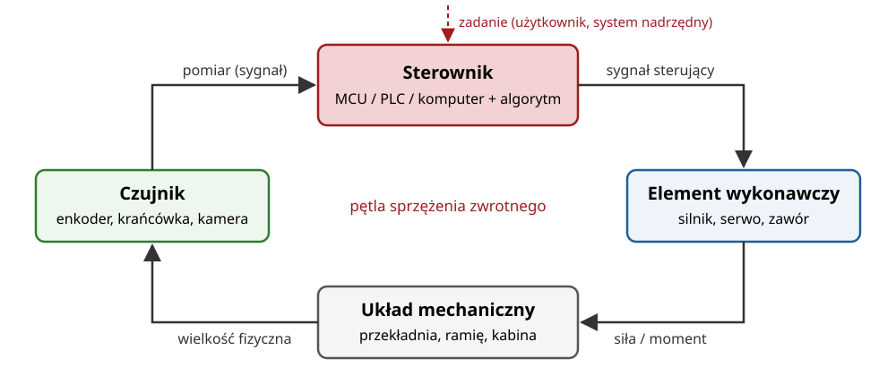
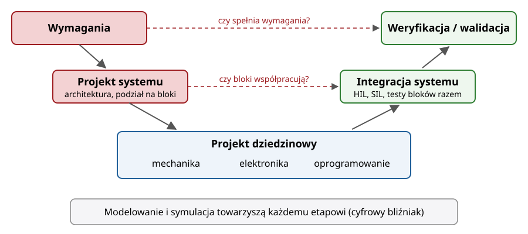
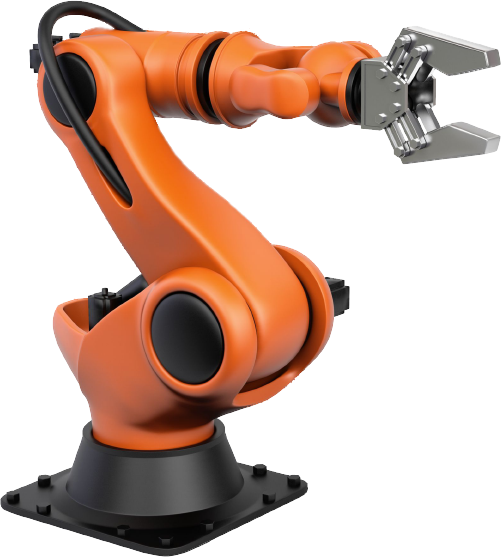

## Plan wykładu

1. Organizacja kursu: wykłady, laboratoria, zaliczenie
2. Definicja systemu mechatronicznego
3. Bloki funkcyjne: czujnik, sterownik, element wykonawczy, mechanika
4. Proces projektowania: model V, modelowanie i symulacja
5. Mapa kursu: od windy na STM32 do robota uczonego z demonstracji

# Organizacja kursu

## Kurs w liczbach

| Forma | Wymiar | Zaliczenie |
|---|---|---|
| Wykład | 15 × 45 min | kolokwium na ostatnim wykładzie (W15) |
| Laboratorium | 5 × 3 h | ocena sprawozdań pisanych na zajęciach |

- Wykład i laboratorium to **dwie niezależne oceny**.
- **Wszystko działa w przeglądarce.** Nie instalujesz nic na swoim komputerze.

## Laboratoria: pięć kroków, jedna historia

| Lab | Narzędzie | Temat | Wykłady |
|---|---|---|---|
| L1 | Wokwi + **STM32** | winda: logika sterująca, silnik krokowy | W01–W03 |
| L2 | **UAIbot** (Python, Colab) | kinematyka i sterowanie manipulatorem | W04–W06 |
| L3 | **ROS 2** (The Construct) | węzły, tematy, usługi, sterownik | W07–W09 |
| L4 | **Gazebo** + ros2_control (The Construct) | UR5: trzy sposoby sterowania | W10–W11 |
| L5 | **LeRobot** (Colab) | wizja → akcja, uczenie z demonstracji | W12–W13 |

::: maly
- Laboratoria są **indywidualne**: zadanie wprowadzające, potem własny projekt.
- Sprawozdanie piszesz **na zajęciach**, dokumentując postępy. Prowadzący ocenia je w trakcie zajęć. Trzeba zaliczyć wszystkie sekcje.
- Na początku zajęć możliwa jest krótka kartkówka.
:::

# System mechatroniczny

## Definicja

::: def
**Mechatronika** to synergiczne połączenie mechaniki, elektroniki, automatyki i informatyki w projektowaniu produktów i procesów.
:::

- Termin: Tetsuro Mori, Yaskawa Electric, 1969.
- Kluczowe słowo: **synergia**. Nie „mechanika + trochę elektroniki”, tylko projekt, w którym funkcje przenosi się między dziedzinami.
- Przykład: zamiast precyzyjnej (drogiej) mechaniki używamy taniej mechaniki + czujnika + algorytmu kompensacji.

::: zrodlo
VDI 2206:2021 *Development of mechatronic and cyber-physical systems*; R. Isermann, *Mechatronic Systems: Fundamentals*, Springer 2005.
:::

## Bloki funkcyjne

{width=78%}

## Przykłady wokół nas

:::: columns
::: {.column width="50%"}
- **Pralka**: czujnik obrotów, falownik, silnik, bęben, niewyważenie wykrywane programowo
- **ABS**: czujnik prędkości koła, sterownik, zawory hydrauliczne
- **Drukarka 3D**: silniki krokowe, krańcówki, grzałki z regulatorem PID
:::
::: {.column width="50%"}
- **Dron**: IMU, regulatory kaskadowe, silniki BLDC
- **Winda** (L1): przyciski, krańcówki, silnik, logika stanów
- **Robot przemysłowy** (L2–L5): enkodery, serwonapędy, kinematyka, planowanie
:::
::::

## Czujniki, sterowniki, elementy wykonawcze

| Blok | Zadanie | Przykłady | Wykład |
|---|---|---|---|
| Czujnik | zamienia wielkość fizyczną na sygnał | enkoder, krańcówka, termopara, kamera | W02 |
| Kondycjonowanie | wzmocnienie, filtracja, przetwarzanie A/C | wzmacniacz operacyjny, ADC | W02 |
| Sterownik | realizuje algorytm | STM32, PLC, PC z ROS 2 | W03, W07–W08 |
| Komunikacja | łączy bloki | UART, I²C, CAN, EtherCAT, DDS | W09 |
| Element wykonawczy | zamienia sygnał na ruch lub siłę | silnik DC, krokowy, serwo | W10 |
| Mechanika | przenosi ruch | przekładnia, śruba, ramię robota | W04–W06 |

# Proces projektowania

## Model V (VDI 2206)

{width=72%}

::: zrodlo
Na podstawie VDI 2206:2021.
:::

## Dlaczego modelujemy i symulujemy

- **Taniej się mylić w symulacji** niż na prototypie (i bezpieczniej dla ludzi).
- Modele na różnych poziomach szczegółowości:
  - logiczny (automat stanów, L1),
  - kinematyczny (geometria ruchu, L2),
  - dynamiczny i fizyczny (masy, siły, kontakt, L4).
- **Cyfrowy bliźniak** (*digital twin*): model zsynchronizowany z rzeczywistym obiektem, używany do testów, diagnostyki, uczenia.
- **SIL / HIL**: *software-in-the-loop* i *hardware-in-the-loop*. Ten sam kod sterownika testujemy najpierw z modelem, potem z prawdziwym sprzętem.

## Narzędzia w tym kursie

| Narzędzie | Klasa | Co modeluje |
|---|---|---|
| Wokwi | symulator mikrokontrolera | STM32 + czujniki + silniki (L1) |
| UAIbot | symulator kinematyki | manipulatory, sterowanie kinematyczne (L2) |
| ROS 2 | middleware robotyczny | komunikacja między modułami (L3) |
| Gazebo | symulator fizyki | dynamika robota, kontakt, czujniki (L4) |
| LeRobot | biblioteka uczenia maszynowego | polityki wizja → akcja (L5) |
| Onshape | CAD w przeglądarce | geometria części (zadanie dodatkowe) |

## Robotyka jako przykład systemu mechatronicznego

:::: columns
::: {.column width="55%"}
- Manipulator: sztywne **ogniwa** połączone **przegubami**, napędzane silnikami.
- **Chwytak** (efektor końcowy) oddziałuje z otoczeniem.
- Ma wszystkie bloki z poprzednich slajdów: enkodery, serwonapędy, sterownik, komunikację, mechanikę.
- Dlatego od W04 wykład prowadzimy na przykładzie robota.
:::
::: {.column width="45%"}
{width=85%}
:::
::::

::: zrodlo
Rysunek: V. M. Gonçalves i in., UAIbot, *Robotic Manipulators*, Lecture 1 (materiały otwarte).
:::

## Podsumowanie

- System mechatroniczny = pętla: **czujnik → sterownik → element wykonawczy → mechanika**, zaprojektowana jako całość.
- Projekt prowadzimy według modelu V i weryfikujemy na każdym etapie symulacją.
- Kolejne wykłady schodzą w głąb bloków: elektronika (W02), mikrokontroler STM32 (W03), kinematyka (W04–W06), oprogramowanie i komunikacja (W07–W09), napędy (W10–W11), uczenie maszynowe (W12–W13).

## Źródła i dalsza lektura

- Karta przedmiotu MID010706 *Systemy mechatroniczne*, W12N PWr.
- VDI 2206:2021, *Development of mechatronic and cyber-physical systems*.
- R. Isermann, *Mechatronic Systems: Fundamentals*, Springer, 2005.
- W. Bolton, *Mechatronics: Electronic Control Systems in Mechanical and Electrical Engineering*, 7th ed., Pearson, 2019.
- B. Siciliano, L. Sciavicco, L. Villani, G. Oriolo, *Robotics: Modelling, Planning and Control*, Springer, 2009.
- UAIbot, *Robotic Manipulator Course*, <https://uaibot.github.io/class_presentations/> (rysunki: tłumaczenie i adaptacja).

