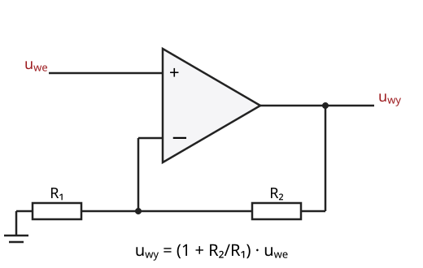
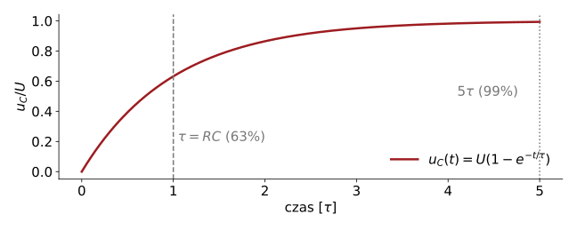
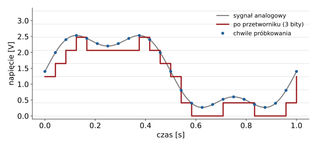
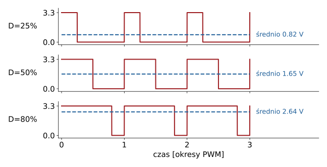
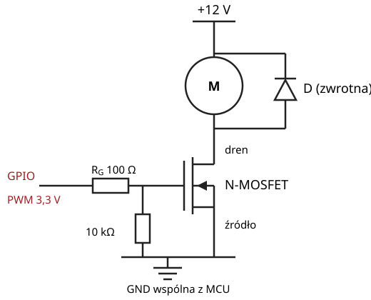
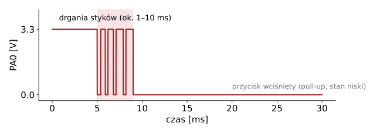

## Plan wykładu

1. Sygnał analogowy i cyfrowy
2. Czujnik i kondycjonowanie sygnału: dzielnik, wzmacniacz operacyjny, filtr RC
3. Przetwornik analogowo-cyfrowy (ADC)
4. Wyjście „analogowe” z mikrokontrolera: PWM
5. Tranzystor jako klucz: sterowanie obciążeniem
6. Logika cyfrowa: bramki, przerzutniki, poziomy logiczne, drgania styków


# Od czujnika do bitu


## Tor pomiarowy

| wielkość fizyczna | → czujnik | → kondycjonowanie | → ADC | → liczba w programie |
|---|---|---|---|---|
| temperatura | termistor NTC | dzielnik, filtr RC | 12 bitów | 0…4095 |
| kąt | potencjometr | wtórnik | 12 bitów | 0…4095 |
| położenie kabiny | krańcówka | pull-up, debouncing | (wejście cyfrowe) | 0 / 1 |

- **Czujnik** zamienia wielkość fizyczną na wielkość elektryczną (rezystancja, napięcie, ładunek, częstotliwość).
- **Kondycjonowanie** dopasowuje sygnał do wejścia przetwornika: zakres, impedancja, pasmo.
- **ADC** zamienia napięcie na liczbę całkowitą.


## Dzielnik napięcia

:::: columns
::: {.column width="55%"}
$$U_{wy} = U_{we}\,\frac{R_2}{R_1 + R_2}$$

- Najprostszy sposób, żeby **czujnik rezystancyjny** (potencjometr, termistor NTC, fotorezystor) dał napięcie.
- Obciążenie wyjścia zmienia wynik: wejście ADC ma skończoną impedancję.
- Potencjometr na osi = **czujnik położenia kątowego** (tak działa serwo modelarskie).
:::
::: {.column width="45%"}
::: przyklad
**Przykład.** NTC 10 kΩ (25 °C) z rezystorem 10 kΩ przy 3,3 V: w 25 °C na wyjściu 1,65 V. W 50 °C (NTC ≈ 3,6 kΩ) napięcie na rezystorze stałym rośnie do ≈ 2,43 V.
:::
:::
::::


## Wzmacniacz operacyjny

:::: columns
::: {.column width="50%"}
{width=95%}
:::
::: {.column width="50%"}
Model idealny:

- nieskończone wzmocnienie różnicowe,
- zerowe prądy wejściowe,
- w pętli ujemnego sprzężenia zwrotnego: $u_+ = u_-$.

Typowe konfiguracje:

- **wtórnik** ($R_2 = 0$): dopasowanie impedancji,
- **nieodwracający**: wzmocnienie $1 + R_2/R_1$,
- **różnicowy**: pomiar na mostku, boczniku prądowym.
:::
::::


## Filtr RC

:::: columns
::: {.column width="55%"}
{width=100%}
:::
::: {.column width="45%"}
- Stała czasowa $\tau = RC$.
- Częstotliwość graniczna filtru dolnoprzepustowego:
$$f_g = \frac{1}{2\pi RC}$$
- Zastosowania: odszumianie pomiaru, antyaliasing przed ADC, wygładzanie PWM, sprzętowe tłumienie drgań styków.
:::
::::


## Przetwornik analogowo-cyfrowy

:::: columns
::: {.column width="58%"}
{width=100%}
:::
::: {.column width="42%"}
- **Rozdzielczość** $N$ bitów: $2^N$ poziomów.
- Najmniejszy krok (LSB): $\Delta = V_{ref}/2^N$. Dla 12 bitów i 3,3 V: 0,81 mV.
- **Próbkowanie** z częstotliwością $f_s$. Twierdzenie Nyquista: sygnał musi mieć pasmo $< f_s/2$, inaczej **aliasing**.
- W STM32C031: 12-bitowy ADC SAR.
:::
::::


## Od bitu do wielkości fizycznej

$$\text{kod} = \left\lfloor \frac{U}{V_{ref}}\,2^N \right\rfloor
\quad\Longrightarrow\quad
U \approx \text{kod}\cdot\frac{V_{ref}}{2^N}$$

```cpp
// STM32duino: domyślnie analogRead() zwraca 10 bitów (zgodność z Arduino)
analogReadResolution(12);                 // pełne 12 bitów
uint32_t kod = analogRead(A0);            // 0 ... 4095
float napiecie = kod * 3.3f / 4096.0f;    // [V]
float kat = napiecie / 3.3f * 270.0f;     // potencjometr 270° -> kąt [°]
```


# Od bitu do silnika


## PWM: modulacja szerokości impulsu

:::: columns
::: {.column width="58%"}
{width=100%}
:::
::: {.column width="42%"}
- Wyjście cyfrowe przełącza się między 0 a $V_{DD}$.
- **Wypełnienie** $D = t_{on}/T$.
- Wartość średnia: $\bar{U} = D \cdot V_{DD}$.
- Obciążenie o dużej bezwładności (silnik, grzałka, dioda widziana przez oko) „uśrednia” sygnał.
- Serwo modelarskie: impuls 1–2 ms co 20 ms koduje **kąt**, nie moc.
:::
::::


## Tranzystor jako klucz

:::: columns
::: {.column width="45%"}
{width=95%}
:::
::: {.column width="55%"}
- Pin mikrokontrolera daje kilka–kilkanaście mA. Silnik potrzebuje amperów.
- **N-MOSFET** po stronie masy (*low-side switch*): bramka sterowana z GPIO, obciążenie między zasilaniem a drenem.
- Wybierz tranzystor typu *logic-level* ($V_{GS(th)}$ wyraźnie poniżej 3,3 V).
- **Dioda zwrotna**: silnik to indukcyjność. Po wyłączeniu prądu napięcie rośnie gwałtownie i zniszczy tranzystor.
- Rezystor 10 kΩ ściąga bramkę do masy, gdy MCU się resetuje.
- Zmiana kierunku obrotów: **mostek H** (W10).
:::
::::


# Logika cyfrowa


## Bramki i poziomy logiczne

:::: columns
::: {.column width="50%"}
| A | B | AND | OR | XOR | NAND |
|---|---|---|---|---|---|
| 0 | 0 | 0 | 0 | 0 | 1 |
| 0 | 1 | 0 | 1 | 1 | 1 |
| 1 | 0 | 0 | 1 | 1 | 1 |
| 1 | 1 | 1 | 1 | 0 | 0 |
:::
::: {.column width="50%"}
- Bramka NAND (lub NOR) jest **funkcjonalnie pełna**: da się z niej zbudować każdą funkcję logiczną.
- Poziomy logiczne: STM32 pracuje w logice **3,3 V**. Część pinów toleruje 5 V (oznaczenie FT w nocie katalogowej), część nie.
- Łącząc moduł 5 V z MCU 3,3 V: sprawdź notę katalogową albo użyj konwertera poziomów.
:::
::::


## Przerzutniki i automaty

- **Przerzutnik D**: zapamiętuje stan wejścia D przy zboczu zegara. To elementarna komórka pamięci.
- Rejestr = n przerzutników. Licznik = rejestr + sumator.
- **Automat skończony** (FSM) = rejestr stanu + logika przejść. W sprzęcie: przerzutniki i bramki. W programie: zmienna `stan` i `switch`.

::: def
**Automat skończony**: skończony zbiór stanów, zdarzenia (wejścia) i funkcja przejścia *(stan, zdarzenie) → nowy stan*, plus akcje (wyjścia). To podstawowe narzędzie opisu logiki sterującej: windy, szlabanu, pralki, sekwencji robota.
:::

Automat windy zaprojektujemy na W03 i zaimplementujemy w L1.


## Wejścia cyfrowe: pull-up i drgania styków

:::: columns
::: {.column width="55%"}
{width=100%}
:::
::: {.column width="45%"}
- Niepodłączone wejście „pływa”: potrzebny rezystor **pull-up** lub **pull-down**. STM32 ma wbudowane (`INPUT_PULLUP`).
- Przycisk mechaniczny **drga** przez kilka ms: jedno wciśnięcie daje wiele zboczy.
- Rozwiązania:
  - sprzętowe: filtr RC + bramka Schmitta,
  - programowe: stan uznajemy za stabilny, gdy nie zmienia się np. przez 20 ms.
:::
::::

::: zrodlo
W Wokwi przycisk domyślnie drga (atrybut `bounce`). To celowe: w L1 musisz to obsłużyć.
:::


## Podsumowanie

- Tor pomiarowy: czujnik → kondycjonowanie (dzielnik, wzmacniacz, filtr) → ADC.
- Tor wykonawczy: GPIO / PWM → klucz tranzystorowy z diodą zwrotną → obciążenie.
- Logika cyfrowa: bramki, przerzutniki, automaty skończone. Te same pojęcia opisują sprzęt i program.
- Na następnym wykładzie wszystko to spotyka się w jednym układzie scalonym: mikrokontrolerze **STM32**.


## Źródła i dalsza lektura

- P. Horowitz, W. Hill, *The Art of Electronics*, 3rd ed., Cambridge University Press, 2015 (rozdz. 1–4, 10).
- W. Bolton, *Mechatronics*, 7th ed., Pearson, 2019 (rozdz. 2–4: czujniki, kondycjonowanie sygnału).
- STMicroelectronics, *STM32C031x4/x6 datasheet (DS13867)* oraz *RM0490 Reference manual*: ADC, GPIO, poziomy logiczne.
- Wokwi Docs, *wokwi-pushbutton*: <https://docs.wokwi.com/parts/wokwi-pushbutton>.

