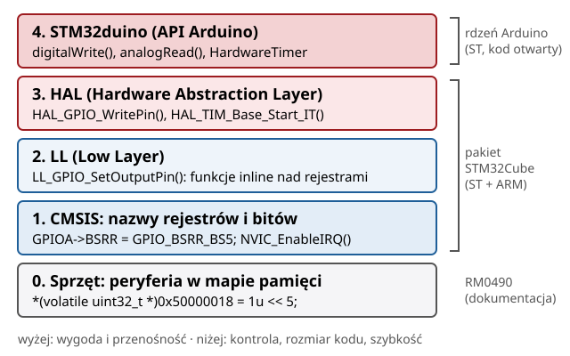
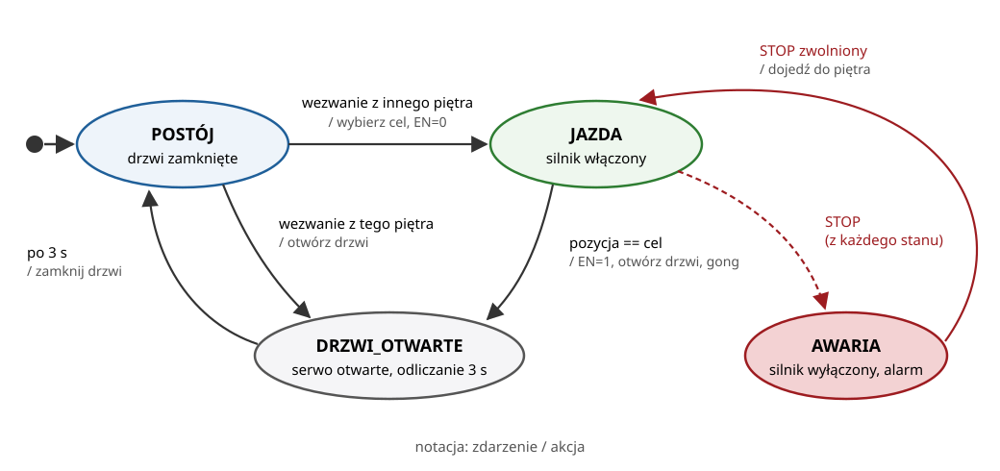

## Plan wykładu

1. Mikrokontroler i rodzina STM32, płytka Nucleo-C031C6
2. Warstwy programowania: sprzęt, CMSIS, LL, HAL, STM32duino
3. STM32duino: API, relacja do narzędzi ST, działanie w Wokwi
4. GPIO: tryby pracy, rejestry
5. Timery: przerwania okresowe i PWM
6. Przerwania i zasady pisania ISR
7. Automat skończony: szkielet programu sterującego
8. Wokwi: STM32 w przeglądarce (przygotowanie do L1)


# Mikrokontroler STM32


## Mikrokontroler to komputer w jednym układzie

:::: columns
::: {.column width="55%"}
- **Rdzeń** (CPU): ARM Cortex-M.
- **Pamięć**: Flash (program), SRAM (dane).
- **Peryferia**: GPIO, timery, ADC, USART, I²C, SPI, przerwania zewnętrzne (EXTI).
- **Zegary** (RCC): każde peryferium trzeba najpierw „włączyć”, podając mu zegar.
- Wszystko w jednym układzie, pobór prądu od µA do dziesiątek mA.
:::
::: {.column width="45%"}
| Rodzina | Rdzeń | Typowo |
|---|---|---|
| **STM32C0** | Cortex-M0+ | 48 MHz, najtańsze |
| STM32F1 | Cortex-M3 | 72 MHz, „Blue Pill” |
| STM32F4 | Cortex-M4F | 84–180 MHz, FPU, DSP |
| STM32G4 | Cortex-M4F | sterowanie silnikami |
| STM32H7 | Cortex-M7 | do 550 MHz |
:::
::::


## Nucleo-C031C6: nasza płytka w L1

:::: columns
::: {.column width="50%"}
- MCU **STM32C031C6**: Cortex-M0+, 48 MHz, 32 KB Flash, 12 KB RAM.
- Złącza zgodne z Arduino Uno: piny **D0–D15**, **A0–A5**.
- Dioda LD4 na **PA5 (D13)**, przycisk USER na PC13.
- Programator ST-LINK z wirtualnym portem szeregowym (USART2: PA2/PA3).
- W Wokwi: `board-st-nucleo-c031c6`.
:::
::: {.column width="50%"}
| Obszar | Adres początkowy |
|---|---|
| Flash (program) | `0x0800 0000` |
| SRAM (dane) | `0x2000 0000` |
| Peryferia APB (TIM, USART…) | `0x4000 0000` |
| Peryferia AHB (RCC…) | `0x4002 0000` |
| Porty GPIO (IOPORT) | `0x5000 0000` |

[Peryferia to po prostu **adresy w pamięci**. Zapis do adresu = zmiana stanu sprzętu.]{.maly}
:::
::::

::: zrodlo
STMicroelectronics, RM0490 *STM32C0x1 reference manual*, rozdz. 2 (mapa pamięci); Wokwi Docs: *board-st-nucleo-c031c6*.
:::


# Warstwy programowania


## Warstwy programowania: przegląd

:::: columns
::: {.column width="55%"}
{width=100%}
:::
::: {.column width="45%"}
- Każda warstwa korzysta z warstwy pod sobą.
- **CMSIS, LL i HAL** to oficjalne biblioteki w pakiecie **STM32Cube** (np. STM32CubeC0).
- **STM32duino** to rdzeń Arduino dla STM32, zbudowany na HAL i LL, rozwijany przez ST jako projekt otwarty.
- W jednym programie **wolno mieszać warstwy**. Na L1 piszesz w API Arduino, a rejestry i LL oglądasz w ćwiczeniu 1.
:::
::::


## Warstwa 0: peryferia w mapie pamięci

:::: columns
::: {.column width="38%"}
::: maly
| Rejestr | Adres | Rola |
|---|---|---|
| `MODER` | `0x50000000` | tryb pinów |
| `IDR` | `0x50000010` | stan wejść |
| `ODR` | `0x50000014` | stan wyjść |
| `BSRR` | `0x50000018` | ustaw/zeruj bity |
| `RCC_IOPENR` | `0x40021034` | zegary portów |

`volatile`: każdy zapis i odczyt musi naprawdę trafić do pamięci, kompilator nie może go pominąć.
:::
:::
::: {.column width="62%"}
```cpp
// Adresy z RM0490, bez żadnej biblioteki
#define RCC_IOPENR  (*(volatile uint32_t *)0x40021034)
#define GPIOA_MODER (*(volatile uint32_t *)0x50000000)
#define GPIOA_BSRR  (*(volatile uint32_t *)0x50000018)

RCC_IOPENR |= 1u << 0;        // bit 0: zegar portu A
GPIOA_MODER = (GPIOA_MODER & ~(3u << 10))
            | (1u << 10);     // PA5: MODE5 = 01
GPIOA_BSRR  = 1u << 5;        // PA5 = 1 (bit set)
GPIOA_BSRR  = 1u << 21;       // PA5 = 0 (5 + 16)
```
:::
::::


## Warstwa 1: CMSIS

:::: columns
::: {.column width="45%"}
- **CMSIS-Core** (ARM): rdzeń Cortex-M, kontroler przerwań **NVIC**, `SysTick`, `__disable_irq()`. Wspólne dla wszystkich producentów.
- **CMSIS-Device** (ST): plik `stm32c031xx.h`
  - struktury rejestrów (`GPIO_TypeDef`, `TIM_TypeDef`),
  - wskaźniki na peryferia (`GPIOA`, `TIM14`, `RCC`),
  - maski bitów: `GPIO_MODER_MODE5_Msk`, `_Pos`.
- Plik startowy: tablica wektorów przerwań (`TIM14_IRQHandler`…).
:::
::: {.column width="55%"}
```cpp
// Ten sam efekt co na poprzednim slajdzie
RCC->IOPENR |= RCC_IOPENR_GPIOAEN;
GPIOA->MODER = (GPIOA->MODER & ~GPIO_MODER_MODE5_Msk)
             | (1U << GPIO_MODER_MODE5_Pos);
GPIOA->BSRR  = GPIO_BSRR_BS5;     // PA5 = 1
GPIOA->BSRR  = GPIO_BSRR_BR5;     // PA5 = 0

// Jak to działa: struktura "nakładana" na adres
typedef struct {
  volatile uint32_t MODER, OTYPER, OSPEEDR, PUPDR,
                    IDR, ODR, BSRR;   // ...
} GPIO_TypeDef;
#define GPIOA ((GPIO_TypeDef *) 0x50000000UL)
```
:::
::::


## CMSIS: timer z przerwaniem na rejestrach

```cpp
// TIM14: przerwanie 1 kHz przy zegarze timera 48 MHz
RCC->APBENR2 |= RCC_APBENR2_TIM14EN;   // 1. zegar peryferium
TIM14->PSC    = 47;                    // 2. 48 MHz / (47+1) = 1 MHz
TIM14->ARR    = 999;                   //    1 MHz / (999+1) = 1 kHz
TIM14->DIER  |= TIM_DIER_UIE;          // 3. przerwanie od przepełnienia (update)
NVIC_SetPriority(TIM14_IRQn, 2);       // 4. CMSIS-Core: kontroler przerwań
NVIC_EnableIRQ(TIM14_IRQn);
TIM14->CR1   |= TIM_CR1_CEN;           // 5. start licznika

extern "C" void TIM14_IRQHandler(void) {   // nazwa z tablicy wektorów
  if (TIM14->SR & TIM_SR_UIF) {
    TIM14->SR = ~TIM_SR_UIF;               // skasuj flagę (bit kasowany zapisem 0)
    GPIOA->ODR ^= GPIO_ODR_OD5;            // przełącz PA5: 500 Hz na wyjściu
  }
}
```

::: uwaga
To kod dla projektu STM32CubeIDE. W STM32duino (i w Wokwi) funkcję `TIM14_IRQHandler` definiuje już rdzeń (klasa `HardwareTimer`), więc druga definicja da błąd konsolidacji. Tam używamy `HardwareTimer`.
:::


## Warstwa 2: LL (Low Layer)

:::: columns
::: {.column width="38%"}
::: maly
- Pliki `stm32c0xx_ll_*.h`: funkcje **`static inline`**, zwykle jedna operacja na rejestrze.
- Czytelne nazwy zamiast masek, **zero narzutu** po kompilacji.
- Nie przechowują stanu, nie sprawdzają błędów.
- Nazwy szyn odpowiadają rejestrom RCC: `APB1_GRP2` = rejestr `APBENR2`.
- STM32duino używa LL tam, gdzie liczy się czas (`digitalWrite`).
:::
:::
::: {.column width="62%"}
```cpp
// GPIO: PA5 jako wyjście, ustaw, przełącz
LL_IOP_GRP1_EnableClock(LL_IOP_GRP1_PERIPH_GPIOA);
LL_GPIO_SetPinMode(GPIOA, LL_GPIO_PIN_5,
                   LL_GPIO_MODE_OUTPUT);
LL_GPIO_SetOutputPin(GPIOA, LL_GPIO_PIN_5);
LL_GPIO_TogglePin(GPIOA, LL_GPIO_PIN_5);

// Timer: te same kroki co na rejestrach
LL_APB1_GRP2_EnableClock(
    LL_APB1_GRP2_PERIPH_TIM14);
LL_TIM_SetPrescaler(TIM14, 47);
LL_TIM_SetAutoReload(TIM14, 999);
LL_TIM_EnableIT_UPDATE(TIM14);
LL_TIM_EnableCounter(TIM14);
```
:::
::::


## Warstwa 3: HAL, konfiguracja GPIO

:::: columns
::: {.column width="40%"}
::: maly
- **Struktura konfiguracji** zamiast pojedynczych rejestrów: opisujesz, *co* chcesz, a HAL wykonuje kroki.
- Funkcje zwracają **kod błędu** (`HAL_OK`, `HAL_ERROR`, `HAL_TIMEOUT`).
- Ten sam kod działa na STM32C0, F4, G4, H7.
- Kod inicjalizacji zwykle **generuje STM32CubeMX** z graficznej konfiguracji pinów i zegarów.
:::
:::
::: {.column width="60%"}
```cpp
GPIO_InitTypeDef gpio = {0};

__HAL_RCC_GPIOA_CLK_ENABLE();     // zegar portu A
gpio.Pin   = GPIO_PIN_5;
gpio.Mode  = GPIO_MODE_OUTPUT_PP; // push-pull
gpio.Pull  = GPIO_NOPULL;
gpio.Speed = GPIO_SPEED_FREQ_LOW;
HAL_GPIO_Init(GPIOA, &gpio);  // MODER, OTYPER,
                              // PUPDR, OSPEEDR
HAL_GPIO_WritePin(GPIOA, GPIO_PIN_5,
                  GPIO_PIN_SET);
HAL_GPIO_TogglePin(GPIOA, GPIO_PIN_5);
HAL_Delay(500);               // licznik SysTick
```
:::
::::


## Warstwa 3: HAL, timer z przerwaniem

```cpp
TIM_HandleTypeDef htim14;                 // "uchwyt": konfiguracja + stan peryferium

void konfigurujTimer(void) {
  __HAL_RCC_TIM14_CLK_ENABLE();
  htim14.Instance         = TIM14;
  htim14.Init.Prescaler   = 47;           // 1 MHz
  htim14.Init.Period      = 999;          // 1 kHz
  htim14.Init.CounterMode = TIM_COUNTERMODE_UP;
  HAL_TIM_Base_Init(&htim14);
  HAL_NVIC_SetPriority(TIM14_IRQn, 2, 0);
  HAL_NVIC_EnableIRQ(TIM14_IRQn);
  HAL_TIM_Base_Start_IT(&htim14);         // start licznika z przerwaniem
}

void TIM14_IRQHandler(void) { HAL_TIM_IRQHandler(&htim14); }   // HAL rozpoznaje źródło

void HAL_TIM_PeriodElapsedCallback(TIM_HandleTypeDef *htim) {  // funkcja zwrotna
  if (htim->Instance == TIM14) { HAL_GPIO_TogglePin(GPIOA, GPIO_PIN_5); }
}
```


# STM32duino


## STM32duino: Arduino na STM32

:::: columns
::: {.column width="58%"}
::: maly
- **Arduino** to nie tylko płytki, ale też **API**: `setup()`, `loop()`, `pinMode()`, `digitalWrite()`…
- **Rdzeń Arduino** (*Arduino core*): implementacja tego API dla danej rodziny układów.
- **Arduino_Core_STM32** (projekt **STM32duino**):
  - rozwija **STMicroelectronics**, kod otwarty (`github.com/stm32duino`),
  - zbudowany na **HAL, LL i CMSIS** z pakietów STM32Cube,
  - obsługuje większość rodzin STM32 i kilkaset płytek.
- **Wariant** płytki: mapa pinów (D13 → PA5), zegary, domyślne timery.
:::
:::
::: {.column width="42%"}
::: maly
| Gdzie działa | Jak |
|---|---|
| Arduino IDE | menedżer płytek *STM32 MCU based boards* |
| PlatformIO | `platform = ststm32`, `framework = arduino` |
| **Wokwi** | kompilacja na serwerze, rdzeń dobrany do płytki |
:::
:::
::::


## API STM32duino: standard Arduino + rozszerzenia STM32

| Standardowe API Arduino | Rozszerzenia STM32duino |
|---|---|
| `pinMode`, `digitalWrite`, `digitalRead` | nazwy pinów portów: `PA5`, `PC13`; szybkie `digitalWriteFast(PA_5, HIGH)` |
| `analogRead`, `analogWrite` | `analogReadResolution(12)`, `analogWriteFrequency(20000)`, `analogWriteResolution(12)` |
| `attachInterrupt`, `millis`, `micros`, `delay` | **`HardwareTimer`**: dowolny timer, przerwania, PWM, pomiar impulsów |
| `Serial`, `Wire` (I²C), `SPI`, `tone`, `Servo` | `HardwareSerial Serial2(PA3, PA2)`: wybór pinów i instancji USART |
| biblioteki Arduino (np. czujniki) | biblioteki ST: `STM32RTC`, `STM32LowPower`, `STM32FreeRTOS` |
| | bezpośrednio: **HAL, LL, CMSIS** w tym samym szkicu |


## Co robi `digitalWrite()` pod spodem

```text
digitalWrite(D13, HIGH)                         cores/arduino/wiring_digital.c
 └─ digitalPinToPinName(D13) → PA_5             wariant NUCLEO_C031C6: numer pinu → port i bit
 └─ digitalWriteFast(PA_5, HIGH)                SrcWrapper/inc/digital_io.h
     └─ digital_io_write(GPIOA, LL_GPIO_PIN_5, 1)
         └─ LL_GPIO_SetOutputPin(GPIOA, LL_GPIO_PIN_5)          warstwa LL
             └─ WRITE_REG(GPIOA->BSRR, GPIO_BSRR_BS5)           warstwa CMSIS
                 └─ zapis 0x00000020 pod adres 0x5000 0018      sprzęt: PA5 = 1
```

- Jedno wywołanie Arduino = **tłumaczenie numeru pinu** + **jeden zapis do rejestru**.
- Koszt tłumaczenia jest mały, ale w pętli o dużej częstotliwości warto użyć `digitalWriteFast(PA_5, …)` albo LL.
- Konfiguracja (`pinMode`) idzie przez HAL (`HAL_GPIO_Init`), bo wykonuje się raz.


## STM32duino a oficjalne narzędzia ST

| | **STM32CubeMX + STM32CubeIDE** | **STM32duino** |
|---|---|---|
| kto rozwija | ST | ST (projekt otwarty) + społeczność |
| konfiguracja | graficzna (plik `.ioc`), generowany kod C | w kodzie, w `setup()` |
| punkt startu | widoczny `main()`, `SystemClock_Config()` | ukryty `main()`, zegary ustawia wariant |
| API | HAL, LL, CMSIS | Arduino + HAL, LL, CMSIS |
| przerwania | piszesz `..._IRQHandler` i funkcje zwrotne | rdzeń obsługuje, Ty podajesz funkcję (`attachInterrupt`) |
| debugowanie | pełny debugger (pułapki, podgląd rejestrów) | ograniczone (monitor portu szeregowego, Wokwi) |
| typowe użycie | produkt, pełna kontrola, certyfikacja | prototyp, dydaktyka, szybki start, biblioteki Arduino |


## STM32duino w Wokwi

:::: columns
::: {.column width="55%"}
1. Piszesz `sketch.ino` i `diagram.json` w przeglądarce.
2. Serwer Wokwi kompiluje szkic **rdzeniem STM32duino** dla płytki `board-st-nucleo-c031c6` (wariant `NUCLEO_C031C6`).
3. Przeglądarka dostaje gotowy plik binarny, taki sam jak dla prawdziwej płytki.
4. Symulator wykonuje instrukcje Cortex-M0+ i symuluje peryferia (GPIO, timery, ADC, USART…) oraz części z `diagram.json`.
:::
::: {.column width="45%"}
Wnioski praktyczne:

- W szkicu działają **wszystkie cztery warstwy** (API Arduino, HAL, LL, CMSIS).
- Procedury obsługi przerwań timerów należą do rdzenia: używaj `HardwareTimer`.
- Biblioteki Arduino dopisujesz w `libraries.txt`.
- Peryferia niesymulowane (DMA, RTC, IWDG) kompilują się, ale nie działają.
:::
::::


## Ten sam efekt w czterech warstwach

```cpp
// 1) Rejestry (CMSIS): włącz zegar portu A, PA5 jako wyjście, ustaw stan wysoki
RCC->IOPENR  |= RCC_IOPENR_GPIOAEN;
GPIOA->MODER  = (GPIOA->MODER & ~GPIO_MODER_MODE5_Msk) | (1U << GPIO_MODER_MODE5_Pos);
GPIOA->BSRR   = GPIO_BSRR_BS5;          // BS = bit set, BR = bit reset (atomowo)

// 2) LL
LL_GPIO_TogglePin(GPIOA, LL_GPIO_PIN_5);

// 3) HAL
HAL_GPIO_TogglePin(GPIOA, GPIO_PIN_5);

// 4) Arduino (STM32duino)
pinMode(LED_BUILTIN, OUTPUT);
digitalWrite(LED_BUILTIN, HIGH);
```

::: uwaga
Wszystkie cztery fragmenty kompilują się w jednym szkicu Wokwi dla Nucleo-C031C6 (ćwiczenie 1 w L1).
:::


## Timer 1 kHz: porównanie warstw

| Warstwa | Konfiguracja | Obsługa przerwania | Linie kodu |
|---|---|---|---|
| rejestry (CMSIS) | RCC, PSC, ARR, DIER, NVIC, CR1 | własny `TIM14_IRQHandler`, kasowanie flagi | ≈ 12 |
| LL | te same kroki, nazwane funkcje | własny `TIM14_IRQHandler`, `LL_TIM_ClearFlag_UPDATE` | ≈ 12 |
| HAL | uchwyt + struktura `Init`, `HAL_TIM_Base_Start_IT` | `HAL_TIM_IRQHandler` + funkcja zwrotna | ≈ 16 |
| STM32duino | `HardwareTimer`, `setOverflow(1000, HERTZ_FORMAT)` | funkcja podana w `attachInterrupt` | **4** |

```cpp
HardwareTimer *timer = new HardwareTimer(TIM14);
timer->setOverflow(1000, HERTZ_FORMAT);   // biblioteka sama liczy PSC i ARR
timer->attachInterrupt(mojaFunkcja);      // wołana z TIM14_IRQHandler rdzenia
timer->resume();
```


## Którą warstwę wybrać

| Sytuacja | Warstwa |
|---|---|
| nauka, prototyp, gotowe biblioteki czujników | **STM32duino** |
| typowy produkt, praca zespołowa, konfiguracja z CubeMX | **HAL** (+ LL w miejscach krytycznych) |
| przerwanie wykonywane 100 000 razy na sekundę, mało pamięci | **LL** lub **rejestry** |
| funkcja peryferium niedostępna w bibliotece | **rejestry** (z RM0490 w ręku) |
| wiele rodzin STM32 w jednym projekcie | **HAL** |

::: uwaga
Niezależnie od warstwy **dokumentacją ostateczną jest reference manual** (RM0490 dla STM32C0). Biblioteki tylko opakowują opisane w nim rejestry.
:::


# GPIO


## Tryby pracy pinu

| Tryb (MODER) | Zastosowanie | Arduino |
|---|---|---|
| `00` wejście | przycisk, krańcówka, sygnał cyfrowy | `pinMode(p, INPUT / INPUT_PULLUP)` |
| `01` wyjście | dioda, STEP/DIR sterownika, przekaźnik | `pinMode(p, OUTPUT)` |
| `10` funkcja alternatywna | PWM z timera, UART, SPI, I²C | `analogWrite`, `Serial`, `HardwareTimer` |
| `11` analogowy | wejście ADC (stan po resecie) | `analogRead` |

- Wyjście: **push-pull** (aktywnie 0 i 1) albo **open-drain** (tylko ściąga do 0, np. magistrala I²C).
- Wejście: rezystor **pull-up / pull-down** wewnątrz układu (ok. 40 kΩ).
- Rejestry danych: `IDR` (odczyt), `ODR` (zapis), `BSRR` (atomowe ustawianie i zerowanie bitów).


# Timery


## Licznik z preskalerem

:::: columns
::: {.column width="55%"}
Timer zlicza impulsy zegara $f_{TIM}$ do wartości `ARR` i się przepełnia:

$$f_{update} = \frac{f_{TIM}}{(PSC+1)(ARR+1)}$$

- `PSC`: preskaler, dzieli zegar.
- `ARR`: rejestr przeładowania, wyznacza okres.
- `CCRx`: rejestr porównania kanału *x*, wyznacza wypełnienie PWM.
:::
::: {.column width="45%"}
::: przyklad
**Serwo 50 Hz** przy $f_{TIM}$ = 48 MHz:

- PSC = 47 → 1 MHz (1 tik = 1 µs),
- ARR = 19 999 → okres 20 ms,
- CCR = 1500 → impuls 1,5 ms (środek zakresu serwa).
:::
:::
::::

STM32C031 ma timery **TIM1, TIM3, TIM14, TIM16, TIM17**. Wszystkie symuluje Wokwi.


## `HardwareTimer` w STM32duino

```cpp
// Przerwanie okresowe: 800 Hz na TIM14 (generator impulsów STEP w windzie)
HardwareTimer *timerKrokow = new HardwareTimer(TIM14);
timerKrokow->setOverflow(800, HERTZ_FORMAT);   // biblioteka sama liczy PSC i ARR
timerKrokow->attachInterrupt(przerwanieKrokow);
timerKrokow->resume();

// PWM 50 Hz dla serwa na pinie D9 = PC7 = TIM3_CH2
PinName pin = digitalPinToPinName(D9);
TIM_TypeDef *tim = (TIM_TypeDef *)pinmap_peripheral(pin, PinMap_PWM);
uint32_t kanal = STM_PIN_CHANNEL(pinmap_function(pin, PinMap_PWM));
HardwareTimer *timerSerwa = new HardwareTimer(tim);
timerSerwa->setPWM(kanal, pin, 50, 5);                             // 50 Hz
timerSerwa->setCaptureCompare(kanal, 1500, MICROSEC_COMPARE_FORMAT); // 1,5 ms
```

::: uwaga
Który timer i kanał obsługuje dany pin? Sprawdzasz w nocie katalogowej (tabela funkcji alternatywnych) albo w pliku `PeripheralPins.c` wariantu płytki.
:::


# Przerwania


## Przerwanie zamiast odpytywania

:::: columns
::: {.column width="52%"}
- **Odpytywanie** (*polling*): pętla `loop()` co chwilę sprawdza stan. Proste, ale opóźnienie zależy od długości pętli.
- **Przerwanie**: sprzęt przerywa program główny i wywołuje procedurę obsługi (ISR).
- Źródła: timer (przepełnienie), EXTI (zbocze na pinie), USART (odebrany bajt), ADC (koniec konwersji).
- Kontroler **NVIC** ustala priorytety.
:::
::: {.column width="48%"}
```cpp
volatile uint32_t impulsy = 0;

void naZbocze() {          // ISR
  impulsy++;
}

void setup() {
  pinMode(D2, INPUT_PULLUP);
  attachInterrupt(digitalPinToInterrupt(D2),
                  naZbocze, FALLING);
}
```
:::
::::


## Zasady pisania ISR

1. **Krótko.** Ustaw flagę, zwiększ licznik, zrób jeden krok. Resztę zrób w `loop()`.
2. **Bez** `delay()`, `Serial.print()`, alokacji pamięci.
3. Zmienne współdzielone z ISR deklaruj jako **`volatile`**.
4. Odczyt wielobajtowej lub złożonej zmiennej w programie głównym: w sekcji krytycznej.

```cpp
noInterrupts();
int32_t kopia = pozycja;   // spójna kopia zmiennej modyfikowanej w ISR
interrupts();
```

::: uwaga
Błędy współbieżności między ISR a `loop()` są najtrudniejsze do znalezienia, bo pojawiają się rzadko i losowo.
:::


# Automat skończony w programie


## Automat windy (L1)

{width=90%}


## Wzorzec: `enum` + `switch` + czas bez `delay()`

```cpp
enum Stan { POSTOJ, JAZDA, DRZWI_OTWARTE, AWARIA };
Stan stan = POSTOJ;
uint32_t wejscieDoStanuMs = 0;

void zmienStan(Stan nowy) { stan = nowy; wejscieDoStanuMs = millis(); }

void loop() {
  uint32_t teraz = millis();
  if (stopWcisniety() && stan != AWARIA) { wylaczSilnik(); zmienStan(AWARIA); }
  switch (stan) {
    case POSTOJ:        if (jestWezwanie()) { ustawCel(); wlaczSilnik(); zmienStan(JAZDA); } break;
    case JAZDA:         if (pozycja() == cel) { wylaczSilnik(); otworzDrzwi(); zmienStan(DRZWI_OTWARTE); } break;
    case DRZWI_OTWARTE: if (teraz - wejscieDoStanuMs >= 3000) { zamknijDrzwi(); zmienStan(POSTOJ); } break;
    case AWARIA:        if (!stopWcisniety()) { dojedzDoPietra(); } break;
  }
}
```

- `loop()` nigdy nie czeka: każdy obieg trwa mikrosekundy, więc program reaguje na wszystko.
- `delay(3000)` w stanie DRZWI_OTWARTE zablokowałby przycisk STOP na 3 s.


## Silnik krokowy ze sterownikiem A4988

:::: columns
::: {.column width="55%"}
- Sterownik przyjmuje dwa sygnały logiczne:
  - **STEP**: każde zbocze narastające = jeden krok (1,8° przy 200 krokach/obr.),
  - **DIR**: kierunek.
- **EN** (aktywne stanem niskim) odłącza uzwojenia.
- Prędkość = częstotliwość impulsów STEP. Generujemy je w przerwaniu timera, a nie w `loop()`.
- Pozycję znamy przez **zliczanie kroków** (sterowanie w pętli otwartej). Szczegóły napędów: W10.
:::
::: {.column width="45%"}
```cpp
void przerwanieKrokow() {       // 800 Hz
  static bool wysoki = false;
  if (wysoki) {
    digitalWrite(PIN_STEP, LOW);
    wysoki = false;
  } else if (pozycja != cel) {
    bool wGore = cel > pozycja;
    digitalWrite(PIN_DIR, wGore);
    digitalWrite(PIN_STEP, HIGH);
    wysoki = true;
    pozycja += wGore ? 1 : -1;
  }
}
```
:::
::::


# Wokwi: STM32 w przeglądarce


## Jak działa projekt w Wokwi

- Nowy projekt: <https://wokwi.com/projects/new/st-nucleo-c031c6>.
- Pliki projektu:
  - `sketch.ino`: program (STM32duino),
  - `diagram.json`: części i połączenia,
  - opcjonalnie `libraries.txt`: biblioteki Arduino.
- Kompilacja na serwerze Wokwi, symulacja rdzenia Cortex-M0+ w przeglądarce.
- Monitor portu szeregowego: `Serial.println()`.
- Części: przyciski (z drganiami styków!), diody, serwo, A4988 + silnik krokowy, brzęczyk, wyświetlacze, czujniki.

| Symulowane w STM32C031 | Niesymulowane |
|---|---|
| GPIO, USART, I²C, SPI, ADC, EXTI, timery TIM1/3/14/16/17 | DMA, RTC, IWDG |

::: zrodlo
Wokwi Docs: <https://docs.wokwi.com/parts/board-st-nucleo-c031c6>.
:::


## Podsumowanie i zadanie przed L1

- STM32 = rdzeń Cortex-M + peryferia widziane jako rejestry w pamięci.
- Warstwy: **rejestry → CMSIS → LL → HAL → STM32duino**. Wyższa warstwa jest wygodniejsza, niższa daje kontrolę. W jednym szkicu wolno je mieszać.
- Timer + przerwanie = precyzyjne generowanie sygnałów niezależnie od programu głównego.
- Program sterujący piszemy jako **automat skończony**, bez blokującego `delay()`.

::: uwaga
**Przed L1:** narysuj na kartce automat windy z 3 piętrami (stany, przejścia, akcje). Konto w Wokwi założymy na początku zajęć.
:::


## Źródła i dalsza lektura

::: maly
- STMicroelectronics, *RM0490: STM32C0x1 reference manual* (RCC, GPIO, TIM, EXTI, NVIC).
- STMicroelectronics, *Description of STM32C0 HAL and low-layer drivers* (user manual); repozytoria `stm32c0xx-hal-driver` i `cmsis-device-c0` (GitHub).
- ARM, *CMSIS 6 documentation: CMSIS-Core (Cortex-M)*, <https://arm-software.github.io/CMSIS_6/>.
- STMicroelectronics, instrukcja użytkownika płytki NUCLEO-C031C6 (st.com, sekcja „Documentation”).
- STM32duino, *Arduino_Core_STM32* (kod źródłowy, wariant `NUCLEO_C031C6`, wiki): <https://github.com/stm32duino/Arduino_Core_STM32>; *HardwareTimer library*: <https://github.com/stm32duino/Arduino_Core_STM32/wiki/HardwareTimer-library>.
- Wokwi Docs: *board-st-nucleo-c031c6*, *wokwi-a4988*, *wokwi-stepper-motor*, *wokwi-servo*, *wokwi-buzzer*: <https://docs.wokwi.com>.
- J. Yiu, *The Definitive Guide to ARM Cortex-M0 and Cortex-M0+ Processors*, 2nd ed., Newnes, 2015.
- G. Brown, *Discovering the STM32 Microcontroller*, Indiana University (wolny podręcznik).
:::

