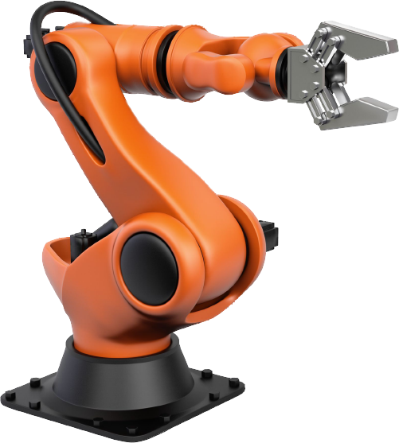
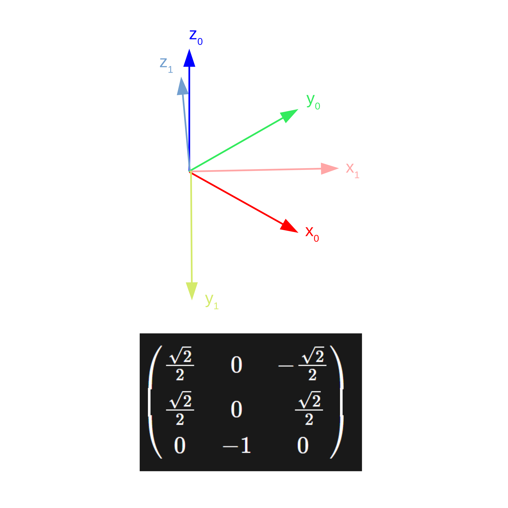
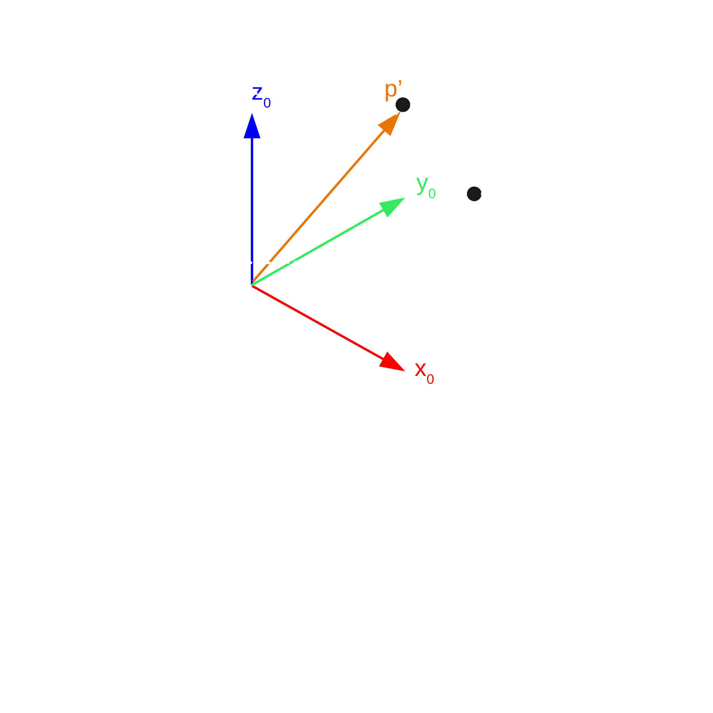
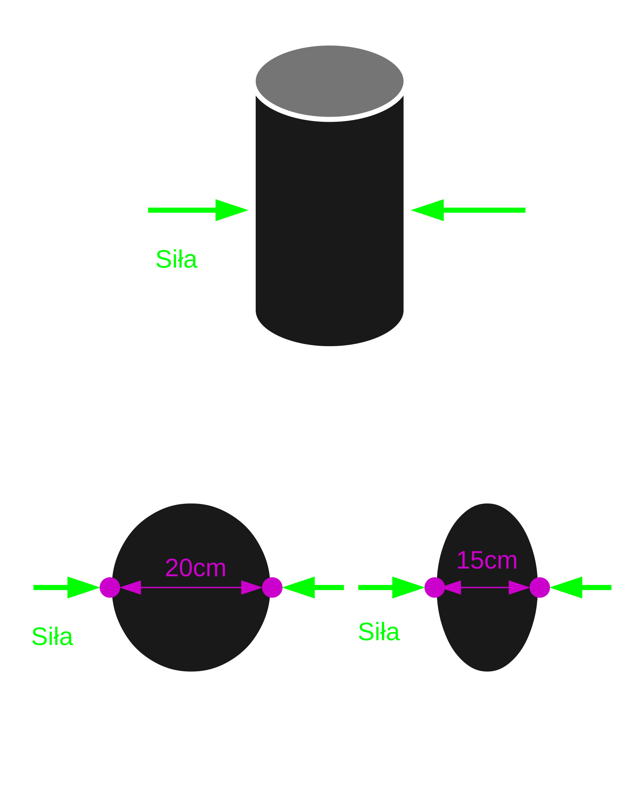
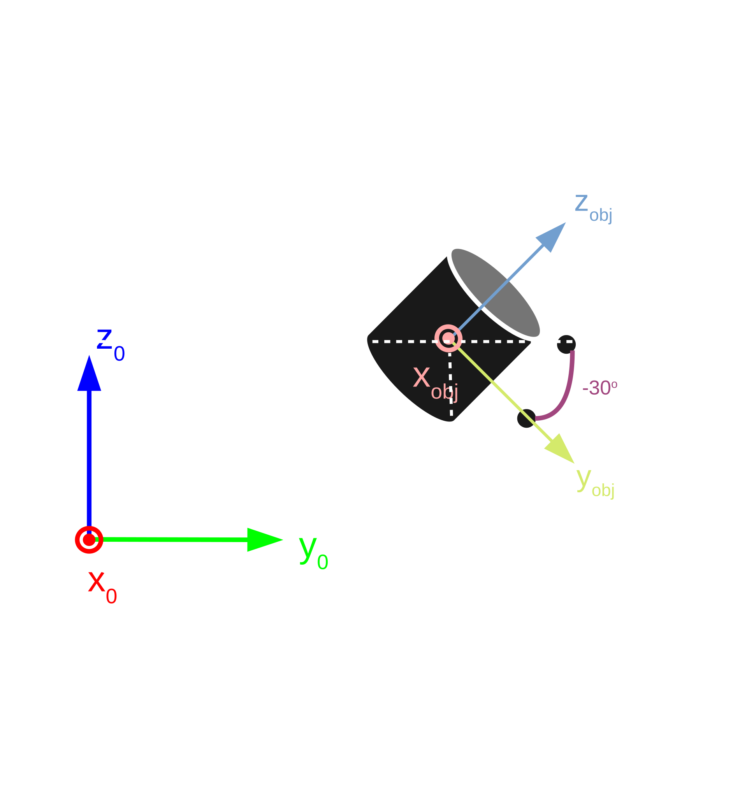
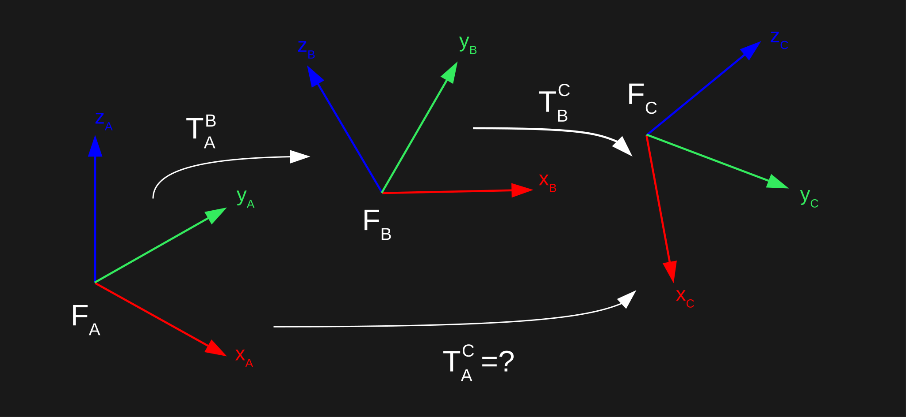

## Skąd ten wykład

::: przyklad
Wykłady **W04–W06** to tłumaczenie i skrót otwartego kursu **UAIbot: Robotic Manipulators** (V. M. Gonçalves i in., UFRN). Rysunki i animacje pochodzą z tego kursu. Animacje są osadzone bezpośrednio ze strony uaibot.github.io, więc wymagają internetu.
:::

- Oryginał (EN): <https://uaibot.github.io/class_presentations/>
- Biblioteka: `pip install uaibot` (Python). Na L2 używamy jej w Google Colab.
- Podręcznik bazowy kursu: B. Siciliano i in., *Robotics: Modelling, Planning and Control*, Springer 2009.


## Plan wykładu

1. Manipulator: przeguby, stopnie swobody, przestrzeń robocza
2. Macierze obrotu: dwie interpretacje
3. Składanie obrotów, kąty Eulera
4. Ciało sztywne i przekształcenie sztywne
5. Macierz transformacji jednorodnej (MTJ)
6. Składanie transformacji: w układzie bazowym i w układzie bieżącym


# Manipulator


## Budowa manipulatora

:::: columns
::: {.column width="55%"}
- Podstawa przymocowana do podłoża.
- Sztywne **ogniwa** połączone **przegubami**.
- Silniki poruszają przegubami.
- **Efektor końcowy** (chwytak, spawarka, narzędzie) oddziałuje z otoczeniem.
- Interesuje nas **model matematyczny** ruchu i **sterowanie**. Większość pojęć przenosi się na inne roboty.
:::
::: {.column width="45%"}
{width=85%}
:::
::::

::: zrodlo
Na podst.: UAIbot, *Robotic Manipulators*, Lecture 1 (tłum. i adapt.).
:::


## Przeguby i stopnie swobody

:::: columns
::: {.column width="50%"}
```{=html}
<iframe class="sym" style="height:200px" data-src="https://uaibot.github.io/class_presentations/presentation/images/aula1/junta_revoluta_robo.html"></iframe>
```
[przegub **obrotowy** (R)]{.maly}

```{=html}
<iframe class="sym" style="height:200px" data-src="https://uaibot.github.io/class_presentations/presentation/images/aula1/junta_prismatica_robo.html"></iframe>
```
[przegub **pryzmatyczny** (liniowy, P)]{.maly}
:::
::: {.column width="50%"}
- **Liczba stopni swobody** (DoF) = liczba niezależnych przegubów.
- Robot przemysłowy typu KUKA KR5: 6 przegubów obrotowych = 6 DoF.
- Więzy odbierają stopnie swobody: robot 6-osiowy z efektorem „przyklejonym” do podłoża (ustalona wysokość i 3 obroty) ma $6 - 4 = 2$ stopnie swobody.
- **Przestrzeń robocza**: zbiór punktów, do których może dotrzeć efektor.
:::
::::

::: zrodlo
Animacje: UAIbot, *Robotic Manipulators*, Lecture 1.
:::


## Klasyczne konfiguracje

| Typ | Przeguby | Przestrzeń robocza | Zastosowanie |
|---|---|---|---|
| Kartezjański | P P P (ortogonalne) | prostopadłościan | drukarki 3D, plotery; łatwy model, brak orientacji |
| Cylindryczny | R P P | walec | pick & place |
| SCARA | R R P | walec | montaż, wciskanie elementów (podatność w x, y, sztywność w z) |
| Antropomorficzny | R R R + nadgarstek R R R | złożona | spawanie, lakierowanie, obsługa maszyn |

::: zrodlo
Na podst.: UAIbot, *Robotic Manipulators*, Lecture 1, „Classic Robot Configurations”.
:::


# Obroty


## Macierz obrotu: definicja

::: def
**Macierz obrotu** to macierz $Q \in \mathbb{R}^{3\times 3}$ spełniająca dwa warunki:

1. $Q^TQ = QQ^T = I_{3\times 3}$,
2. $\det(Q) = +1$.
:::

Zapiszmy $Q$ kolumnami: $Q = \begin{pmatrix} Q_x & Q_y & Q_z \end{pmatrix}$. Warunek 1 oznacza, że kolumny są **ortonormalne**:

$$Q_x^TQ_y = Q_x^TQ_z = Q_y^TQ_z = 0, \qquad Q_x^TQ_x = Q_y^TQ_y = Q_z^TQ_z = 1.$$

Warunek 2: układ jest **prawoskrętny** (reguła prawej dłoni).

::: zrodlo
Na podst.: UAIbot, *Robotic Manipulators*, Class 2: Spatial Description (tłum. i adapt.).
:::


## Interpretacja A: macierz obrotu jako układ odniesienia

:::: columns
::: {.column width="55%"}
- Weź układ $\mathcal{F}_0$. Narysuj w nim trzy wektory: kolumny $Q_x, Q_y, Q_z$.
- Otrzymujesz nowy układ $\mathcal{F}_1$ o **tym samym środku**.

::: def
Macierz obrotu $Q$ opisuje układ $\mathcal{F}_1$ zapisany względem układu $\mathcal{F}_0$.
:::
:::
::: {.column width="45%"}
{width=100%}
:::
::::

::: zrodlo
Rysunek: UAIbot, *Robotic Manipulators*, Class 2.
:::


## Interpretacja B: macierz obrotu jako operator

:::: columns
::: {.column width="55%"}
Macierz $Q$ **obraca punkt** wokół pewnej osi (zapisanej w $\mathcal{F}_0$) o pewien kąt, zgodnie z regułą prawej dłoni.

$$Q = \begin{pmatrix} \tfrac{\sqrt{2}}{2} & -\tfrac{\sqrt{2}}{2} & 0 \\ \tfrac{\sqrt{2}}{2} & \tfrac{\sqrt{2}}{2} & 0 \\ 0 & 0 & 1 \end{pmatrix},\quad
p = \begin{pmatrix} \tfrac{\sqrt{2}}{2} \\ \tfrac{\sqrt{2}}{2} \\ \tfrac12 \end{pmatrix} \Rightarrow
p' = Qp = \begin{pmatrix} 0 \\ 1 \\ \tfrac12 \end{pmatrix}$$

$p'$ to punkt $p$ obrócony o 45° wokół osi $z_0$.
:::
::: {.column width="45%"}
{width=100%}
:::
::::

::: zrodlo
Na podst.: UAIbot, *Robotic Manipulators*, Class 2 (tłum. i adapt.).
:::


## Związek obu interpretacji

- Osie układu $\mathcal{F}_0$ w nim samym: $x_0 = (1\ 0\ 0)^T$, $y_0 = (0\ 1\ 0)^T$, $z_0 = (0\ 0\ 1)^T$.
- Obróćmy je operatorem $Q$ (interpretacja B): $x_1 = Qx_0,\ y_1 = Qy_0,\ z_1 = Qz_0$.
- Ale $Qx_0$ to po prostu pierwsza kolumna $Q$! Dostajemy ten sam układ $\mathcal{F}_1$ co w interpretacji A.

```python
import numpy as np
import uaibot as ub

Q = np.array([[0, -1, 0], [1, 0, 0], [0, 0, 1]])
os_obrotu, kat = ub.Utils.axis_angle(Q)
print(os_obrotu)   # [0. 0. 1.]
print(kat)         # 1.5707... rad (90°)
```


## Obroty elementarne i ich składanie

:::: columns
::: {.column width="50%"}
$$R_x(\theta) = \begin{pmatrix} 1 & 0 & 0 \\ 0 & c_\theta & -s_\theta \\ 0 & s_\theta & c_\theta \end{pmatrix}$$
$$R_y(\theta) = \begin{pmatrix} c_\theta & 0 & s_\theta \\ 0 & 1 & 0 \\ -s_\theta & 0 & c_\theta \end{pmatrix}$$
$$R_z(\theta) = \begin{pmatrix} c_\theta & -s_\theta & 0 \\ s_\theta & c_\theta & 0 \\ 0 & 0 & 1 \end{pmatrix}$$
:::
::: {.column width="50%"}
- Dwa kolejne obroty $Q_1$, potem $Q_2$ (oba względem $\mathcal{F}_0$) to obrót $Q_3 = Q_2Q_1$.
- **Nowszy obrót stoi po lewej!**
- Obroty **nie są przemienne**: $Q_2Q_1 \neq Q_1Q_2$.

::: przyklad
$R_x(90°)R_y(90°)$ to obrót o 120° wokół osi $\tfrac{\sqrt3}{3}(1\ 1\ 1)^T$, a $R_y(90°)R_x(90°)$ wokół $\tfrac{\sqrt3}{3}(1\ 1\ {-1})^T$.
:::
:::
::::


## Reprezentacje obrotu

- Macierz obrotu ma 9 liczb, ale tylko **3 stopnie swobody** (warunek $Q^TQ = I$).
- **Kąty Eulera**: każdą macierz obrotu da się rozłożyć jako $Q = R_z(\alpha)R_y(\beta)R_x(\gamma)$.
  - 3 liczby, ale: złożenie dwóch obrotów nie jest proste,
  - reprezentacja **niejednoznaczna** (dla $\beta = \pi/2$ nieskończenie wiele trójek),
  - **nieciągła**: bliskie obroty mogą mieć zupełnie różne kąty. Utrudnia to różniczkowanie.
- **Kwaterniony**: 4 liczby, ciągłe, prawie jednoznaczne (dwa kwaterniony na obrót). Standard w ROS 2 i Gazebo (W08, W11).
- W tym kursie: **macierze**, bo tak pisze większość literatury robotycznej.

```python
alfa, beta, gamma = ub.Utils.euler_angles(Q)   # Q = Rz(alfa) Ry(beta) Rx(gamma)
```

::: zrodlo
Na podst.: UAIbot, *Robotic Manipulators*, Class 2, „Representations” (tłum. i adapt.).
:::


# Ciało sztywne


## Ciało sztywne i przekształcenie sztywne

:::: columns
::: {.column width="55%"}
::: def
**Ciało sztywne**: zbiór punktów, w którym odległość między dowolnymi dwoma punktami nie zmienia się w czasie:
$\|p_1(t_A) - p_2(t_A)\| = \|p_1(t_B) - p_2(t_B)\|$.
:::

- Idealizacja: stalowy walec tak, piłka plażowa nie.
- **Przekształcenie sztywne** $T$ zachowuje odległości między punktami.
- Każde właściwe (bez odbicia) przekształcenie sztywne to $T(p) = Qp + s$: obrót + przesunięcie.
:::
::: {.column width="45%"}
{width=100%}
:::
::::

::: zrodlo
Na podst.: UAIbot, *Robotic Manipulators*, Class 2, „Rigid Body” (tłum. i adapt.).
:::


## Układ przyczepiony do obiektu

:::: columns
::: {.column width="55%"}
- „Przyczepiamy” układ $\mathcal{F}_{obj}$ do ciała: każde przekształcenie ciała przekształca też układ.
- Znając położenie $\mathcal{F}_{obj}$ w chwili $t$, znamy położenie **wszystkich** punktów ciała.
- Ruch ciała opisujemy więc przekształceniem $T_t$ między $\mathcal{F}_0$ a $\mathcal{F}_{obj}$ w każdej chwili: czyli parą $Q(t)$, $s(t)$.
- Przykład obok: obrót o $-30°$ wokół $x_0$, przesunięcie o 2 w $y_0$ i o 1 w $z_0$.
:::
::: {.column width="45%"}
{width=100%}
:::
::::

::: zrodlo
Rysunek: UAIbot, *Robotic Manipulators*, Class 2.
:::


# Transformacja jednorodna


## Macierz transformacji jednorodnej (MTJ)

::: def
**MTJ** to macierz $H \in \mathbb{R}^{4\times4}$:
$$H = \begin{pmatrix} Q & s \\ 0_{1\times3} & 1 \end{pmatrix}$$
gdzie $Q$ jest macierzą obrotu, a $s \in \mathbb{R}^{3}$ wektorem przesunięcia. MTJ ↔ przekształcenie sztywne.
:::

- **Złożenie** przekształceń $T_2(T_1(p)) = (Q_2Q_1)p + (Q_2s_1 + s_2)$ to po prostu **iloczyn macierzy** $H_3 = H_2H_1$.
- MTJ podstawowe: $R_x(\theta), R_y(\theta), R_z(\theta)$ (obroty) i $D(s)$ (przesunięcie, w skrócie $D_x, D_y, D_z$).
- W UAIbot: `Utils.rotx`, `Utils.roty`, `Utils.rotz`, `Utils.trn`. Dlatego obroty w UAIbot mają wymiar 4×4.

::: zrodlo
Na podst.: UAIbot, *Robotic Manipulators*, Class 2, „Homogeneous Transformation Matrix” (tłum. i adapt.).
:::


## Dwie interpretacje MTJ

:::: columns
::: {.column width="55%"}
1. **Operator**: przekształcenie sztywne $T(p) = Qp + s$ w układzie $\mathcal{F}_0$.
2. **Układ odniesienia**: układ $\mathcal{F}_1$ zapisany w $\mathcal{F}_0$. Rysujemy osie z kolumn $Q$, a środek przesuwamy o $s$.

Uwaga: pojedyncza MTJ mówi, jak ciało wygląda **w jednej chwili**. Nic nie mówi o tym, jak się tam znalazło. Ruch to funkcja $H(t)$.
:::
::: {.column width="45%"}
```{=html}
<iframe class="sym" data-src="https://uaibot.github.io/class_presentations/presentation/images/aula2/anim1.html"></iframe>
```
:::
::::

::: zrodlo
Animacja: UAIbot, *Robotic Manipulators*, Class 2 („Continuous Description of Movement”).
:::


## Składanie: od prawej do lewej, w układzie bazowym

:::: columns
::: {.column width="45%"}
$$H = R_x(\tfrac{\pi}{4})\, D_y(-0{,}25)\, R_z(\tfrac{\pi}{2})\, D_x(1)$$

- Czytamy **od prawej**: najpierw $D_x(1)$, potem $R_z$, $D_y$, $R_x$.
- Każde przekształcenie względem **nieruchomego** $\mathcal{F}_0$.
- Mnożenie **z lewej** strony = operacja w układzie bazowym.
:::
::: {.column width="55%"}
```{=html}
<iframe class="sym" data-src="https://uaibot.github.io/class_presentations/presentation/images/aula2/anim2.html"></iframe>
```
:::
::::

::: zrodlo
Animacja: UAIbot, *Robotic Manipulators*, Class 2 („Composition of HTMs”).
:::


## Składanie: od lewej do prawej, w układzie bieżącym

:::: columns
::: {.column width="45%"}
- Tę samą macierz $H$ można czytać **od lewej**, jeśli każde przekształcenie wykonujemy względem **bieżącego** (już przesuniętego) układu.
- Układ końcowy jest identyczny. Różnią się tylko układy pośrednie.
- Mnożenie **z prawej** strony = operacja w układzie bieżącym.
- W robotyce częściej mnożymy z prawej.
:::
::: {.column width="55%"}
```{=html}
<iframe class="sym" data-src="https://uaibot.github.io/class_presentations/presentation/images/aula2/anim3.html"></iframe>
```
:::
::::

::: zrodlo
Animacja: UAIbot, *Robotic Manipulators*, Class 2 („Composition of HTMs”).
:::


## Łańcuch transformacji

:::: columns
::: {.column width="55%"}
- Oznaczenie: $T_A^B$ = transformacja z $\mathcal{F}_A$ do $\mathcal{F}_B$ = układ $\mathcal{F}_B$ zapisany w $\mathcal{F}_A$.
- Łańcuch (mnożenie z prawej):
$$T_A^C = T_A^B\, T_B^C, \qquad T_A^D = T_A^B\, T_B^C\, T_C^D$$
- Tak liczymy położenie chwytaka robota: od podstawy, ogniwo po ogniwie (W05).
- W ROS 2 ten sam mechanizm realizuje biblioteka **tf2** (W08, W11).
:::
::: {.column width="45%"}
{width=100%}
:::
::::

```python
H = ub.Utils.rotx(np.pi/4) * ub.Utils.trn([0, -0.25, 0]) * ub.Utils.rotz(np.pi/2) * ub.Utils.trn([1, 0, 0])
```

::: zrodlo
Na podst.: UAIbot, *Robotic Manipulators*, Class 2, „Chain of transformations” (tłum. i adapt.).
:::


## Podsumowanie

- Pozycja + orientacja = **poza** ciała sztywnego.
- Ruch ciała opisujemy, przyczepiając do niego układ $\mathcal{F}_{obj}$ i podając w każdej chwili MTJ $H(t)$ względem nieruchomego $\mathcal{F}_0$.
- MTJ ma dwie interpretacje (operator i układ) i składa się przez mnożenie macierzy.
- Kolejność ma znaczenie: z lewej = w układzie bazowym, z prawej = w układzie bieżącym.

::: uwaga
**Na L2** policzysz te macierze w UAIbot i narysujesz układy w symulatorze 3D.
:::


## Źródła i dalsza lektura

- V. M. Gonçalves i in., **UAIbot: Robotic Manipulators**, Class 1–2, <https://uaibot.github.io/class_presentations/> (źródło slajdów, rysunków i animacji; tłumaczenie i adaptacja własna).
- UAIbot, dokumentacja Pythona: <https://uaibot.github.io/> oraz repozytorium <https://github.com/UAIbot/UAIbotPy>.
- B. Siciliano, L. Sciavicco, L. Villani, G. Oriolo, *Robotics: Modelling, Planning and Control*, Springer, 2009, rozdz. 2.
- K. M. Lynch, F. C. Park, *Modern Robotics: Mechanics, Planning, and Control*, Cambridge University Press, 2017, rozdz. 3 (wolna wersja PDF i wykłady wideo).
- P. Corke, *Robotics, Vision and Control*, 3rd ed., Springer, 2023, rozdz. 2.

