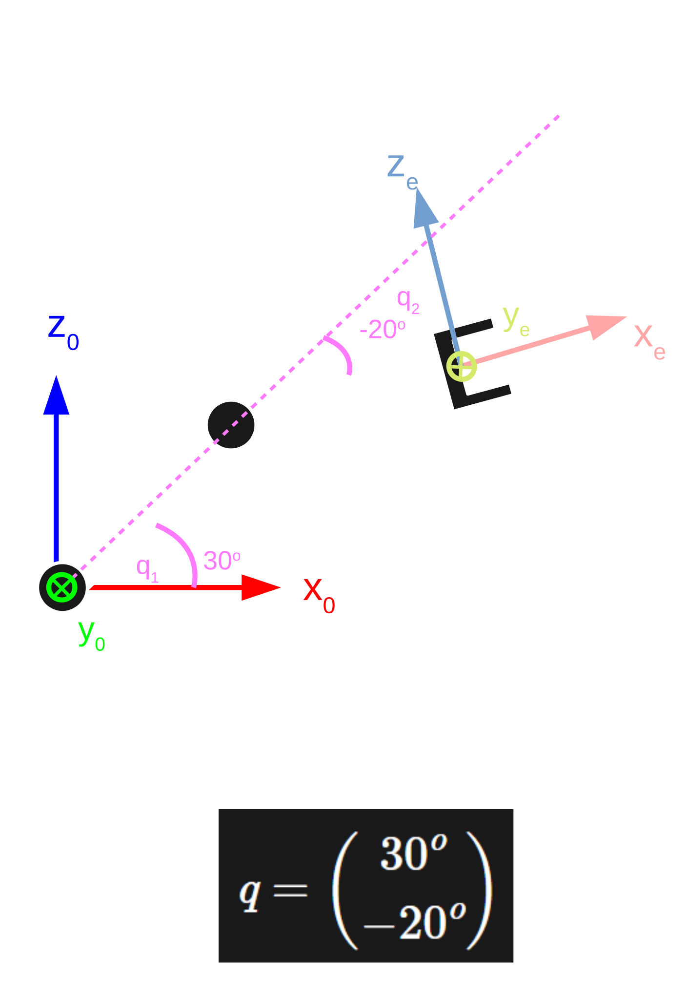
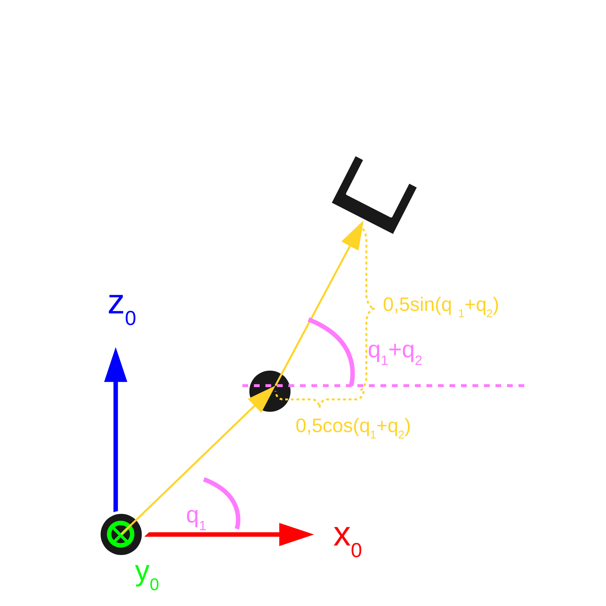
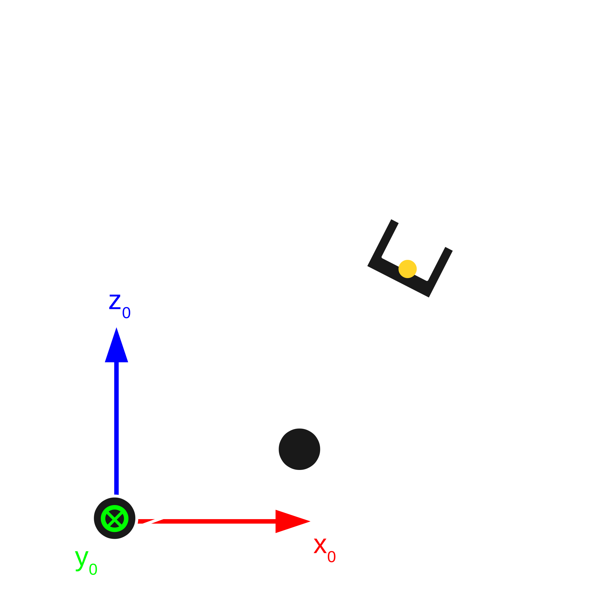
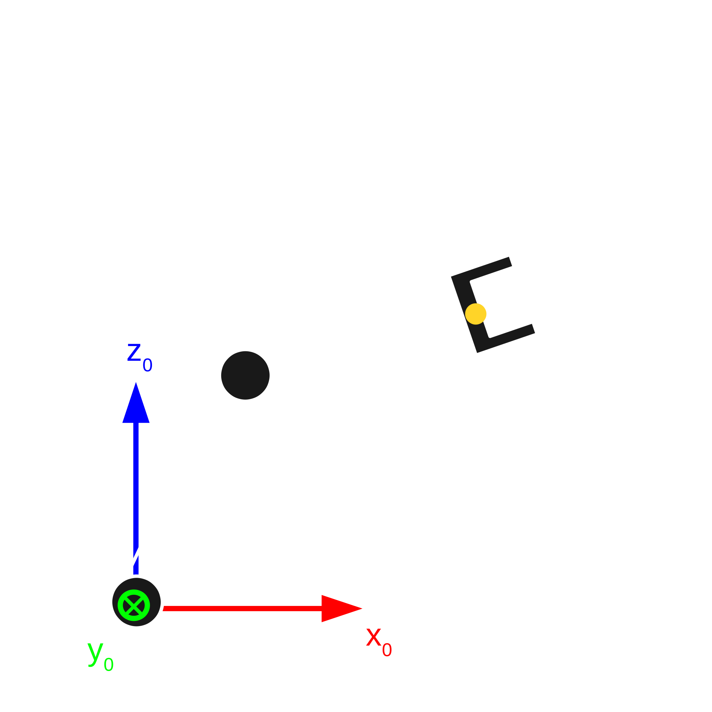

## Plan wykładu

1. Konfiguracja robota
2. Kinematyka prosta: przykład robota płaskiego
3. Notacja Denavita-Hartenberga (DH)
4. Kinematyka odwrotna: przykład analityczny i metody numeryczne
5. Funkcje UAIbot: `fkm`, `ikm`, parametry DH

::: zrodlo
Wykład na podst.: V. M. Gonçalves i in., UAIbot, *Robotic Manipulators*, Class 3: Forward and Inverse Kinematics (tłum. i adapt.).
:::


# Kinematyka prosta


## Konfiguracja

::: def
**Konfiguracja** robota o $n$ przegubach w chwili $t$ to wektor kolumnowy $q \in \mathbb{R}^{n}$: kąt obrotu każdego przegubu obrotowego i przesunięcie każdego przegubu liniowego.
:::

:::: columns
::: {.column width="55%"}
- Kierunek dodatni i położenie zerowe przegubu to **konwencja**, zwykle ustalona przez producenta.
- Znając $q$, znamy położenie każdego punktu robota. To ogólna definicja konfiguracji w mechanice.
- **Kinematyka prosta**: funkcja $H_0^e = f(q)$ dająca pozę efektora w układzie $\mathcal{F}_0$.
:::
::: {.column width="45%"}
{height=340px}
:::
::::


## Przykład: robot płaski 2R

:::: columns
::: {.column width="55%"}
- Dwa przeguby obrotowe, ogniwa po 0,5 m. Kierunek dodatni: przeciwnie do ruchu wskazówek zegara. Dla $q_1 = q_2 = 0$ ramię wyprostowane w prawo.
- Wektor od 1. do 2. przegubu: $v_1 = (0{,}5c_1,\ 0,\ 0{,}5s_1)^T$.
- Od 2. przegubu do efektora: kąt $q_1 + q_2$, więc $v_2 = (0{,}5c_{12},\ 0,\ 0{,}5s_{12})^T$.
- Położenie efektora: $s(q) = v_1 + v_2$.
- Orientacja: obrót o $-(q_1+q_2)$ wokół $y_0$.
:::
::: {.column width="45%"}
{width=100%}
:::
::::

[Oznaczenia: $c_1 = \cos q_1$, $s_1 = \sin q_1$, $c_{12} = \cos(q_1+q_2)$, $s_{12} = \sin(q_1+q_2)$.]{.maly}


## Wynik: MTJ efektora

$$H_0^e(q) = \begin{pmatrix}
c_{12} & 0 & -s_{12} & 0{,}5c_1 + 0{,}5c_{12} \\
0 & 1 & 0 & 0 \\
s_{12} & 0 & c_{12} & 0{,}5s_1 + 0{,}5s_{12} \\
0 & 0 & 0 & 1
\end{pmatrix}$$

- Wariant z trzecim przegubem **liniowym** (długość ogniwa $0{,}25 + q_3$): w ostatniej kolumnie $0{,}5$ przy $c_{12}, s_{12}$ zamienia się na $(0{,}25 + q_3)$.
- Nie każda konfiguracja jest dozwolona: **limity przegubów** i **samokolizje**. W tym kursie zakładamy, że sterownik ich nie narusza. W praktyce potrzebny jest nadzór.

::: zrodlo
Na podst.: UAIbot, *Robotic Manipulators*, Class 3, Examples 1–2 (tłum. i adapt.).
:::


# Notacja Denavita-Hartenberga


## Po co DH

- Dla robota płaskiego wystarczy trygonometria. Dla robota 6-osiowego w 3D analiza „na piechotę” jest nieporęczna i podatna na błędy.
- **Konwencja DH** mówi, **jak przyczepić układ** do każdego ogniwa, tak aby przejście między kolejnymi układami opisywały zawsze **4 liczby**.
- Robot o $n$ przegubach: $n+1$ układów $\mathcal{F}_{DH0}, \dots, \mathcal{F}_{DHn}$. $\mathcal{F}_{DH0}$ na nieruchomej podstawie, $\mathcal{F}_{DHi}$ na $i$-tym ogniwie.


## Przepis na układy DH

Dla $i = 0, \dots, n$:

1. $\text{prosta}_i$: oś przegubu $i$; $\text{prosta}_{i+1}$: oś przegubu $i+1$.
2. Punkt $P_{i,i+1}$ na $\text{prosta}_i$ najbliższy $\text{prostej}_{i+1}$, punkt $P_{i+1,i}$ na $\text{prosta}_{i+1}$ najbliższy $\text{prostej}_i$.
3. Środek $\mathcal{F}_{DHi}$ w punkcie $P_{i+1,i}$.
4. Oś $z_{DHi}$ wzdłuż $\text{prostej}_{i+1}$ (jeden z dwóch zwrotów).
5. Oś $x_{DHi}$ od $P_{i,i+1}$ do $P_{i+1,i}$ (znormalizowana).
6. Oś $y_{DHi}$ z reguły prawej dłoni.

Przypadki niejednoznaczne (wybór należy do inżyniera): $i = 0$, osie równoległe, osie przecinające się, $i = n$.

::: zrodlo
Na podst.: UAIbot, *Robotic Manipulators*, Class 3, „The Denavit-Hartenberg Convention” (tłum. i adapt.).
:::


## Przykład: układy DH robota

```{=html}
<iframe class="sym" style="height:520px" data-src="https://uaibot.github.io/assets/dh1_no_caption.html"></iframe>
```

::: zrodlo
Animacja interaktywna: UAIbot, *Robotic Manipulators*, Class 3, DH Example 1 (obracaj myszą).
:::


## Parametry DH

Przejście z $\mathcal{F}_{DH(i-1)}$ do $\mathcal{F}_{DHi}$ opisują 4 parametry (operacje w **bieżącym** układzie):

| Parametr | Operacja |
|---|---|
| $\theta_i$ | obrót wokół bieżącej osi $z$, aż $x$ pokryje się z następną osią $x$ |
| $d_i$ | przesunięcie wzdłuż bieżącej osi $z$ |
| $\alpha_i$ | obrót wokół bieżącej osi $x$, aż $z$ pokryje się z następną osią $z$ |
| $a_i$ | przesunięcie wzdłuż bieżącej osi $x$ |

$$H_{DH(i-1)}^{DHi}(q_i) = R_z(\theta_i)\, D_z(d_i)\, R_x(\alpha_i)\, D_x(a_i)$$

- Przegub obrotowy: **$\theta_i$ zmienne** (zależy od $q_i$), pozostałe stałe.
- Przegub liniowy: **$d_i$ zmienne**.


## Parametry DH: przykład interaktywny

```{=html}
<iframe class="sym" style="height:520px" data-src="https://uaibot.github.io/assets/dh4_no_caption.html"></iframe>
```

::: zrodlo
Animacja: UAIbot, *Robotic Manipulators*, Class 3, „Example 1 of Parameter Calculation”. Parametry konstrukcyjne (stałe) i zmienne zależne od $q$.
:::


## Kinematyka prosta z DH

$$H_{DH0}^{DHn}(q) = H_{DH0}^{DH1}(q_1)\, H_{DH1}^{DH2}(q_2) \cdots H_{DH(n-1)}^{DHn}(q_n)$$

- Układ $\mathcal{F}_{DH0}$ nie musi być „naszym” $\mathcal{F}_0$, a $\mathcal{F}_{DHn}$ nie musi być układem efektora $\mathcal{F}_e$ (np. środek szczęk chwytaka). Dodajemy stałe macierze dopasowujące:

$$H_0^e(q) = H_0^{DH0}\; H_{DH0}^{DHn}(q)\; H_{DHn}^{e}$$

- Parametry DH podaje producent w dokumentacji albo mierzymy je sami.
- Uwaga: istnieją inne konwencje (zmodyfikowana DH Craiga, opis URDF w ROS). Zawsze sprawdź, której używa dokumentacja.


# Kinematyka odwrotna


## Problem

::: def
**Kinematyka odwrotna**: dana jest pożądana poza efektora $\hat{H}_0^e$. Znaleźć $q$ takie, że $H_0^e(q) = \hat{H}_0^e$.
:::

- Układ nieliniowych równań trygonometrycznych.
- Może mieć **jedno, wiele albo zero** rozwiązań.
- Przykład: robot płaski 2R, szukamy tylko pozycji $(x_a, z_a)$, orientacja dowolna (kinematyka odwrotna „częściowa”).

$$L_1c_1 + L_2c_{12} = x_a, \qquad L_1s_1 + L_2s_{12} = z_a$$


## Rozwiązanie analityczne dla 2R

:::: columns
::: {.column width="58%"}
Podnosimy do kwadratu i dodajemy:
$$\cos q_2 = \frac{x_a^2 + z_a^2 - (L_1^2 + L_2^2)}{2L_1L_2}$$

- Rozwiązanie istnieje, gdy $(L_1 - L_2)^2 \le x_a^2 + z_a^2 \le (L_1 + L_2)^2$. To dokładnie przestrzeń robocza!
- Dwa rozwiązania $q_2 = \pm\arccos(\cdot)$: „łokieć w górę” i „łokieć w dół”.
- Dla wybranego $q_2$ układ liniowy względem $(c_1, s_1)$ daje
$q_1 = \operatorname{atan2}(V, U)$.
:::
::: {.column width="42%"}
{width=48%} {width=48%}
:::
::::


## Kod: kinematyka odwrotna 2R

```python
import numpy as np

def znajdz_q1(L1, L2, xa, za, q2):
    G = xa**2 + za**2
    c2, s2 = np.cos(q2), np.sin(q2)
    U = ((L1 + L2*c2)*xa + L2*s2*za) / G
    V = (-L2*s2*xa + (L1 + L2*c2)*za) / G
    return np.arctan2(V, U)

def kinematyka_odwrotna(L1, L2, xa, za):
    G = xa**2 + za**2
    if G >= (L1 + L2)**2 or G <= (L1 - L2)**2:
        raise ValueError("Punkt poza przestrzenią roboczą")
    q2 = np.arccos((G - (L1**2 + L2**2)) / (2*L1*L2))
    return [znajdz_q1(L1, L2, xa, za, q2), q2], [znajdz_q1(L1, L2, xa, za, -q2), -q2]

print(kinematyka_odwrotna(1.0, 1.5, 0.8, 0.5))   # dwa rozwiązania
```

::: zrodlo
Kod: UAIbot, *Robotic Manipulators*, Class 3 (nazwy przetłumaczone).
:::


## Rozwiązania numeryczne

- Analityczne rozwiązanie dla ogólnego robota 6-osiowego bywa bardzo trudne (to osobny temat badań).
- W praktyce: **metody numeryczne**, iteracyjnie poprawiające $q$ tak, by zmniejszyć błąd pozy.
- Najprostsza idea: symulujemy **sterowanie kinematyczne** (W06) na modelu robota. Jeśli zbiegnie, końcowe $q$ rozwiązuje kinematykę odwrotną. Tak działa `robot.ikm()` w UAIbot.
- W ROS 2 / MoveIt: solwery KDL, TRAC-IK, pick_ik (L4).


# UAIbot


## Funkcje UAIbot do kinematyki

```python
import numpy as np
import uaibot as ub
np.set_printoptions(precision=3, suppress=True)

robot = ub.Robot.create_kuka_kr5()
print(robot.q)                          # bieżąca konfiguracja, wektor (6, 1)

H = robot.fkm()                         # kinematyka prosta dla robot.q (MTJ 4x4 efektora)
H = robot.fkm(q=[0, 1, 2, 3, 4, 5])     # ... dla zadanej konfiguracji
H_dh = robot.fkm(q=robot.q, axis='dh')  # lista MTJ wszystkich układów DH

for i, ogniwo in enumerate(robot.links):  # parametry DH
    print(i + 1, ogniwo.joint_type, ogniwo.theta, ogniwo.d, ogniwo.alpha, ogniwo.a)

cel = ub.Utils.trn([0, 0, -0.3]) * robot.fkm()   # 30 cm niżej niż teraz
q_cel = robot.ikm(htm_tg=cel)                    # kinematyka odwrotna (numeryczna)
```

::: uwaga
W nowszych wersjach UAIbot argument `ikm` nazywa się `htm_tg` (w materiałach oryginalnych: `htm_target`).
:::


## Animacja w UAIbot

```python
robot = ub.Robot.create_kuka_kr5()
sim = ub.Simulation([robot])

dt, tmax = 0.01, 10
for i in range(round(tmax / dt)):
    t = i * dt
    q = (1 - t/tmax) * robot.q0 + (t/tmax) * q_cel   # interpolacja liniowa w przestrzeni przegubów
    robot.add_ani_frame(time=t, q=q)

sim.run()                                  # w Colab/Jupyter wyświetla animację
# sim.save("wyniki", "animacja")           # poza notatnikiem: plik HTML
```

- `add_ani_frame` = interfejs „zadana konfiguracja” (więcej o interfejsach sterowania: W06).
- Interpolacja w przestrzeni przegubów **nie** daje prostej linii ruchu efektora.


## Podsumowanie

- Kinematyka prosta: $q \mapsto H_0^e(q)$, liczona łańcuchem MTJ. Konwencja DH standaryzuje ten łańcuch (4 parametry na przegub).
- Kinematyka odwrotna: $H \mapsto q$. Nieliniowa, wiele rozwiązań lub brak. Analitycznie tylko w prostych przypadkach, w praktyce numerycznie.
- Na L2: kinematyka prosta KUKA KR5 w UAIbot, porównanie z własnym rozwiązaniem dla 2R.


## Źródła i dalsza lektura

- V. M. Gonçalves i in., **UAIbot: Robotic Manipulators**, Class 3, <https://uaibot.github.io/class_presentations/> (źródło treści, rysunków i animacji DH; tłumaczenie i adaptacja własna).
- UAIbot Cookbook (Python): *Calculating robot forward kinematics*, *Accessing robot D-H parameters*, <https://uaibot.github.io/>.
- J. Denavit, R. S. Hartenberg, *A kinematic notation for lower-pair mechanisms based on matrices*, J. Applied Mechanics 22 (1955) 215–221.
- B. Siciliano i in., *Robotics: Modelling, Planning and Control*, Springer, 2009, rozdz. 2.8–2.12.
- K. M. Lynch, F. C. Park, *Modern Robotics*, Cambridge University Press, 2017, rozdz. 4 i 6.

