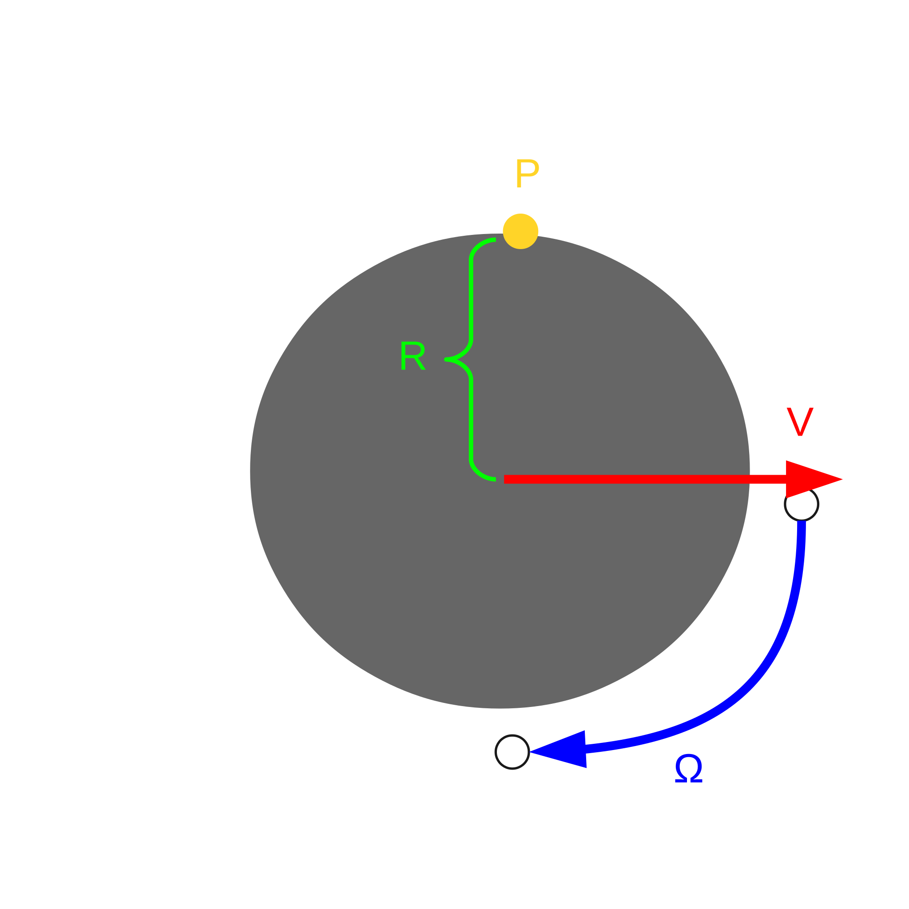

## Plan wykładu

1. Prędkość liniowa i kątowa ciała sztywnego
2. Jakobian geometryczny
3. Osobliwości i ruch w przestrzeni zerowej
4. Odwrotna kinematyka różniczkowa: tłumiona pseudoodwrotność
5. Interfejsy sterowania robotem
6. Sterowanie kinematyczne: funkcja zadania i prawo sterowania

::: zrodlo
Wykład na podst.: V. M. Gonçalves i in., UAIbot, *Robotic Manipulators*, Class 4: Differential Kinematics i Class 5: Kinematic Control (tłum. i skrót).
:::


# Prędkość ciała sztywnego


## Operator S i pochodna macierzy obrotu

:::: columns
::: {.column width="50%"}
::: def
Dla $a = (a_x\ a_y\ a_z)^T$:
$$S(a) = \begin{pmatrix} 0 & -a_z & a_y \\ a_z & 0 & -a_x \\ -a_y & a_x & 0 \end{pmatrix}$$
:::

- $S(a)^T = -S(a)$ (antysymetryczna),
- $S(a)\,b = a \times b$ (iloczyn wektorowy jako mnożenie macierzy),
- $S(Qa) = Q\,S(a)\,Q^T$.
:::
::: {.column width="50%"}
**Twierdzenie.** Dla każdej zmiennej w czasie macierzy obrotu $Q(t)$ istnieje wektor $\omega(t)$ taki, że
$$\dot{Q}(t) = S\big(\omega(t)\big)\,Q(t).$$

::: przyklad
$Q(t) = R_z(2t)$ ⇒ $\dot{Q}Q^T = S\big((0\ 0\ 2)^T\big)$, więc $\omega = (0\ 0\ 2)^T$ rad/s: obrót wokół $z$ z prędkością 2 rad/s.
:::

W UAIbot: `ub.Utils.S(a)`.
:::
::::


## Prędkość liniowa i kątowa

:::: columns
::: {.column width="55%"}
Punkt $P$ ciała ma stałe współrzędne $p^P_{obj}$ w układzie ciała. W $\mathcal{F}_0$:
$p^P_0(t) = Q(t)\,p^P_{obj} + s(t)$. Po zróżniczkowaniu:

$$\boxed{\;v^P_0 = \omega \times (p^P_0 - s) + v\;}$$

- $v = \dot{s}$: **prędkość liniowa** ciała,
- $\omega$: **prędkość kątowa**, z $S(\omega) = \dot{Q}Q^T$.
- Uogólnienie szkolnego $V + \Omega R$ (toczący się krążek).
- $v$, $\omega$ to cechy **całego ciała**, nie punktu.
:::
::: {.column width="45%"}
{width=95%}
:::
::::

::: zrodlo
Na podst.: UAIbot, *Robotic Manipulators*, Class 4, „Linear and Angular Velocity” (tłum. i adapt.).
:::


# Jakobian geometryczny


## Od prędkości przegubów do prędkości efektora

Robot 2R z W05: różniczkujemy $s(q)$ po czasie (reguła łańcuchowa):

$$v = \underbrace{\begin{pmatrix} -0{,}5s_1 - 0{,}5s_{12} & -0{,}5s_{12} \\ 0 & 0 \\ 0{,}5c_1 + 0{,}5c_{12} & 0{,}5c_{12} \end{pmatrix}}_{J_v(q)} \begin{pmatrix} \dot{q}_1 \\ \dot{q}_2 \end{pmatrix},
\qquad
\omega = \underbrace{\begin{pmatrix} 0 & 0 \\ -1 & -1 \\ 0 & 0 \end{pmatrix}}_{J_\omega(q)} \dot{q}$$

- Prędkości zależą **nieliniowo od $q$**, ale **liniowo od $\dot{q}$**.
- Dla $q = (\pi/4,\ 0)$, $\dot{q} = (1,\ 1)$ rad/s: $v = (-\sqrt2,\ 0,\ \sqrt2)^T$ m/s, $\omega = (0,\ -2,\ 0)^T$ rad/s.


## Jakobian geometryczny: przypadek ogólny

$$\xi = \begin{pmatrix} v \\ \omega \end{pmatrix} = J_{geo}(q)\,\dot{q}, \qquad J_{geo}(q) = \begin{pmatrix} J_v(q) \\ J_\omega(q) \end{pmatrix} \in \mathbb{R}^{6\times n}$$

Kolumna $j$ z układów DH ($z_{DH(j-1)}$: oś przegubu $j$, $s$: środki układów):

| | przegub obrotowy | przegub liniowy |
|---|---|---|
| kolumna $J_v$ | $z_{DH(j-1)} \times (s_e - s_{DH(j-1)})$ | $z_{DH(j-1)}$ |
| kolumna $J_\omega$ | $z_{DH(j-1)}$ | $0$ |

```python
Jg, H = robot.jac_geo()                 # Jakobian 6 x n i MTJ efektora (dla robot.q)
qdot = np.matrix([1, 1, 1, 1, 1, 1]).T
v, w = Jg[0:3, :] * qdot, Jg[3:6, :] * qdot
```

::: zrodlo
Na podst.: UAIbot, *Robotic Manipulators*, Class 4, „Geometric Jacobian” (tłum. i adapt.).
:::


## Osobliwości

:::: columns
::: {.column width="50%"}
- Czy robot może w konfiguracji $q$ osiągnąć **dowolną** prędkość $\xi_d \in \mathbb{R}^6$? Tylko gdy $n \ge 6$ i $\operatorname{rank} J_{geo}(q) = 6$.
- Prędkości osiągalne = $\operatorname{Im}(J_{geo}(q))$, wymiar $\operatorname{rank} J_{geo}$.
- **Konfiguracja osobliwa**: rząd $J_{geo}$ nie jest pełny.
- **Prawie osobliwa**: bardzo małe wartości szczególne. Wymagałaby ogromnych $\dot{q}$. W praktyce równie groźna.
:::
::: {.column width="50%"}
```{=html}
<iframe class="sym" data-src="https://uaibot.github.io/class_presentations/presentation/images/aula4/anim5.html"></iframe>
```
[KUKA KR5 w konfiguracji początkowej jest osobliwy: nie zrealizuje jednocześnie $v_d$ (cyjan) i $\omega_d$ (żółty).]{.maly}
:::
::::


## Ruch w przestrzeni zerowej

:::: columns
::: {.column width="50%"}
- $\operatorname{Ker}(J_{geo}(q))$: prędkości przegubów, które **nie ruszają efektora**. Wymiar $n - \operatorname{rank} J_{geo}$.
- Robot o $n > 6$ (np. KUKA LBR iiwa, 7 osi) ma ją zawsze: może zmieniać kształt ramienia przy nieruchomym chwytaku.
- Zastosowanie: omijanie przeszkód, unikanie limitów przegubów, człowiek obok robota.
:::
::: {.column width="50%"}
```{=html}
<iframe class="sym" data-src="https://uaibot.github.io/class_presentations/presentation/images/aula4/anim6.html"></iframe>
```
:::
::::

::: zrodlo
Animacje: UAIbot, *Robotic Manipulators*, Class 4, „Analyses with the Geometric Jacobian”.
:::


## Odwrotna kinematyka różniczkowa

Chcemy rozwiązać $J_{geo}(q)\,\dot{q} = \xi_d$. Układ liniowy $Au = b$ ma jedno, nieskończenie wiele albo zero rozwiązań. Jedno podejście do wszystkich trzech przypadków:

$$\min_u \|Au - b\|^2 + \epsilon\|u\|^2 \quad\Rightarrow\quad u = \underbrace{(A^TA + \epsilon I)^{-1}A^T}_{A^{\dagger(\epsilon)}}\, b$$

- $\epsilon \to 0^+$: **pseudoodwrotność** $A^\dagger$. Blisko osobliwości „wybucha”.
- Małe $\epsilon > 0$ (typowo $10^{-3}$): **tłumiona pseudoodwrotność**. Kompromis między dokładnością a rozsądnymi prędkościami.

```python
xi_d = np.matrix([0, 0, 0.2*np.cos(t), 0, 0, 0]).T   # efektor w górę i w dół
Jg, H = robot.jac_geo()
qdot = ub.Utils.dp_inv(Jg, 0.001) * xi_d               # dp_inv = damped pseudoinverse
```

::: zrodlo
Na podst.: UAIbot, *Robotic Manipulators*, Class 4, „Inverse Differential Kinematics” (tłum. i adapt.).
:::


# Sterowanie kinematyczne


## Interfejsy sterowania robotem

| Wysyłamy do robota | Model | Kto używa |
|---|---|---|
| moment silników $\tau$ | $\ddot{q} = f(q, \dot{q}, \tau)$, zależy od mas i bezwładności | badacze, producenci; sterowanie siłą |
| prędkość przegubów $\dot{q}_d$ | $\dot{q} = \dot{q}_d$ | **sterowanie kinematyczne (ten wykład)** |
| konfigurację $q_d$ | $q = q_d$ | bardzo częste w przemyśle (L4: `joint_trajectory_controller`) |
| pozę efektora $\hat{H}_d$ | kinematyka odwrotna producenta | najczęstsze u integratorów |

- Nawet przy interfejsie pozycyjnym można realizować sterowanie kinematyczne: $q_d(t) = q_0 + \int_0^t u\,dt$.
- W L4 zobaczysz te interfejsy w ROS 2 jako różne kontrolery `ros2_control`.

::: zrodlo
Na podst.: UAIbot, *Robotic Manipulators*, Class 5, „Overview” (tłum. i adapt.).
:::


## Funkcja zadania

Model: $\dot{q} = u$. Zadanie: np. efektor ma osiągnąć pozę $H_d$.

::: def
**Funkcja zadania** $r(q) \in \mathbb{R}^g$: różniczkowalna i taka, że $r(q) = 0 \iff q$ realizuje zadanie.
:::

Dla pełnej pozy (kolumny MTJ: osie $x, y, z$ i położenie $s$):

$$r(q) = \begin{pmatrix} s_e(q) - s_d \\ 1 - x_d^T x_e(q) \\ 1 - y_d^T y_e(q) \\ 1 - z_d^T z_e(q) \end{pmatrix},
\qquad
J_r(q) = \begin{pmatrix} J_v(q) \\ x_d^T S(x_e) J_\omega(q) \\ y_d^T S(y_e) J_\omega(q) \\ z_d^T S(z_e) J_\omega(q) \end{pmatrix}$$

- $1 - a^Tb = 0 \iff a = b$ dla wektorów jednostkowych. Różniczkowalne wszędzie, w przeciwieństwie do kątów Eulera.
- Zadanie częściowe (np. orientacja wokół osi $z$ dowolna): usuwamy odpowiednie wiersze.


## Prawo sterowania

Żądamy wykładniczego zaniku błędu: $\dot{r} = -Kr$, $K > 0$ ⇒ $r(t) = e^{-Kt}r(0)$. Z reguły łańcuchowej:

$$J_r(q,t)\,\dot{q} + \frac{\partial r}{\partial t} = -K r
\quad\Rightarrow\quad
\boxed{\;u = -J_r^{\dagger(\epsilon)}\Big(K r + \frac{\partial r}{\partial t}\Big)\;}$$

- $\partial r/\partial t$: człon **feedforward**, niezerowy dla zadań zmiennych w czasie (śledzenie trajektorii).
- $K$: szybkość zbieżności (reguła inżynierska: zbieżność po $\approx 5/K$ s). Większe $K$ = większe prędkości silników.
- $\epsilon$: większe = łagodniejsze sterowanie, ale większa szansa, że zadanie nie zostanie wykonane.
- Sterownik jest **nieliniowy** w $q$. Nie uwzględnia kolizji: w praktyce potrzebny nadzór.
- Uogólnienie: $\dot{r} = F(r)$, np. funkcja nasycenia dla bardziej równomiernej zbieżności.

::: zrodlo
Na podst.: UAIbot, *Robotic Manipulators*, Class 5, „The Kinematic Control Technique” (tłum. i adapt.).
:::


## Szkielet programu sterującego

```python
dt, t, tmax = 0.01, 0.0, 6.0                          # pętla sterowania 100 Hz
robot = ub.Robot.create_kuka_kr5()
H_d = ub.Utils.trn([-0.3, 0.2, -0.3]) * robot.fkm()   # poza docelowa
x_d, y_d, z_d, s_d = H_d[0:3, 0], H_d[0:3, 1], H_d[0:3, 2], H_d[0:3, 3]
sim = ub.Simulation([robot, ub.Frame(htm=H_d)])
K, eps = 2.0, 0.001

for i in range(round(tmax / dt)):
    q = robot.q                                        # "pomiar" konfiguracji
    Jg, H = robot.jac_geo(q)
    x_e, y_e, z_e, s_e = H[0:3, 0], H[0:3, 1], H[0:3, 2], H[0:3, 3]
    r = np.vstack([s_e - s_d, 1 - x_d.T*x_e, 1 - y_d.T*y_e, 1 - z_d.T*z_e])
    Jr = np.vstack([Jg[0:3, :], x_d.T*ub.Utils.S(x_e)*Jg[3:6, :],
                    y_d.T*ub.Utils.S(y_e)*Jg[3:6, :], z_d.T*ub.Utils.S(z_e)*Jg[3:6, :]])
    u = -ub.Utils.dp_inv(Jr, eps) * (K * r)            # prawo sterowania
    robot.add_ani_frame(time=t + dt, q=q + u*dt)       # "robot" wykonuje prędkość u przez dt
    t += dt
sim.run()
```

::: zrodlo
Na podst. kodu z UAIbot, *Robotic Manipulators*, Class 5, Example 1 (uproszczone, nazwy przetłumaczone).
:::


## Wynik: sterowanie pozą KUKA KR5

:::: columns
::: {.column width="55%"}
```{=html}
<iframe class="sym" data-src="https://uaibot.github.io/class_presentations/presentation/images/aula5/anim2.html"></iframe>
```
:::
::: {.column width="45%"}
- $K = 2\ \text{s}^{-1}$, $\epsilon = 10^{-3}$.
- Położenie zbiega szybko, orientacja „leniwie” na końcu: tak działa zanik wykładniczy.
- Z funkcją $F(r)$ o stałej szybkości zaniku (nasycenie) zbieżność jest równomierniejsza.
- To samo sterowanie z członem feedforward śledzi okrąg (przykład 2 w oryginale).
:::
::::

::: zrodlo
Animacja: UAIbot, *Robotic Manipulators*, Class 5, Example 1.
:::


## Podsumowanie

- $\xi = J_{geo}(q)\,\dot{q}$: Jakobian łączy prędkości przegubów z prędkością efektora.
- Osobliwości ograniczają osiągalne prędkości; nadmiarowość daje ruch w przestrzeni zerowej.
- Sterowanie kinematyczne: wybierz funkcję zadania $r$, policz $J_r$, zastosuj $u = -J_r^{\dagger(\epsilon)}(Kr + \partial r/\partial t)$.
- Ten sam algorytm, symulowany „na sucho”, rozwiązuje kinematykę odwrotną.

::: uwaga
**Na L2** zaimplementujesz sterownik pozy i śledzenie okręgu dla KUKA KR5, zbadasz wpływ $K$ i $\epsilon$.
:::


## Źródła i dalsza lektura

- V. M. Gonçalves i in., **UAIbot: Robotic Manipulators**, Class 4–5, <https://uaibot.github.io/class_presentations/> (źródło treści, kodu i animacji; tłumaczenie i skrót własny).
- UAIbot, *Utils.dp_inv*, *Robot.jac_geo*, *Robot.task_function*: dokumentacja API, <https://uaibot.github.io/>.
- B. Siciliano i in., *Robotics: Modelling, Planning and Control*, Springer, 2009, rozdz. 3 (kinematyka różniczkowa, pseudoodwrotność tłumiona).
- K. M. Lynch, F. C. Park, *Modern Robotics*, Cambridge University Press, 2017, rozdz. 5 (Jakobian, osobliwości).
- C. W. Wampler, *Manipulator inverse kinematic solutions based on vector formulations and damped least-squares methods*, IEEE Trans. SMC 16(1), 1986.

