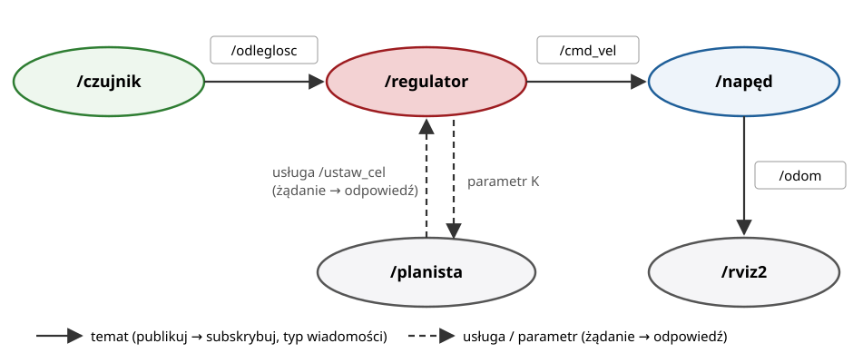

## Plan wykładu

1. Czym jest ROS 2 i po co go używać
2. Graf obliczeniowy: węzły i tematy
3. Usługi, akcje, parametry
4. Pierwszy węzeł w Pythonie (`rclpy`)
5. Przestrzeń robocza, pakiety, `colcon`, pliki launch
6. DDS i jakość usług (QoS)
7. Narzędzia: CLI, `rqt_graph`, `rviz2`, `ros2 bag`, `tf2`
8. The Construct: ROS 2 w przeglądarce (przygotowanie do L3)


# ROS 2


## Czym jest ROS 2

- **ROS** (*Robot Operating System*): nie system operacyjny, tylko **middleware** + narzędzia + ekosystem pakietów dla robotów.
- Rozwiązuje wspólne problemy: komunikacja między modułami, opis robota (URDF), transformacje (tf2), wizualizacja, nagrywanie danych, sterowniki sprzętu.
- Ten sam kod sterownika działa z prawdziwym robotem i z symulatorem Gazebo (L4).
- ROS 2 (od 2017) zastąpił ROS 1: brak centralnego węzła master, komunikacja przez **DDS**, wsparcie czasu rzeczywistego, bezpieczeństwo.

| Dystrybucja | Wydanie | Wsparcie do | Uwagi |
|---|---|---|---|
| Humble Hawksbill | 05.2022 | 05.2027 | LTS, Ubuntu 22.04 |
| **Jazzy Jalisco** | 05.2024 | 05.2029 | **LTS, Ubuntu 24.04, para z Gazebo Harmonic (L3, L4)** |
| Lyrical Luth | 05.2026 | 05.2031 | LTS, para z Gazebo Jetty |

::: zrodlo
ROS 2 Documentation, *Distributions*, <https://docs.ros.org/en/jazzy/Releases.html>.
:::


## Graf obliczeniowy

{width=86%}


## Elementy grafu

| Element | Wzorzec | Kiedy używać | Przykład |
|---|---|---|---|
| **węzeł** (*node*) | proces z jedną odpowiedzialnością | zawsze | `/regulator` |
| **temat** (*topic*) | publikuj/subskrybuj, 1:N, asynchronicznie | strumień danych | odczyty czujnika, `/cmd_vel` |
| **usługa** (*service*) | żądanie → odpowiedź, krótko | zapytanie lub polecenie natychmiastowe | `/ustaw_cel`, reset |
| **akcja** (*action*) | cel → informacja zwrotna → wynik, można anulować | zadanie trwające sekundy | „jedź do punktu”, `FollowJointTrajectory` (L4) |
| **parametr** | wartość konfiguracyjna węzła | strojenie bez rekompilacji | wzmocnienie $K$ |

- Każdy temat, usługa i akcja ma **typ** zdefiniowany w pliku `.msg`, `.srv`, `.action`, np. `geometry_msgs/msg/Twist`.


# Programowanie


## Węzeł publikujący (Python)

```python
import rclpy
from rclpy.node import Node
from std_msgs.msg import Float32


class Czujnik(Node):
    def __init__(self):
        super().__init__('czujnik')
        self.pub = self.create_publisher(Float32, 'odleglosc', 10)   # temat, głębokość kolejki
        self.create_timer(0.1, self.pomiar)                          # 10 Hz
        self.t = 0.0

    def pomiar(self):
        self.t += 0.1
        self.pub.publish(Float32(data=1.0 + 0.5 * (self.t % 4.0)))


def main():
    rclpy.init()
    rclpy.spin(Czujnik())       # pętla obsługi zdarzeń: timery, subskrypcje, usługi
    rclpy.shutdown()
```


## Węzeł subskrybujący z parametrem

```python
from geometry_msgs.msg import Twist

class Regulator(Node):
    def __init__(self):
        super().__init__('regulator')
        self.declare_parameter('K', 0.8)             # ros2 param set /regulator K 1.5
        self.declare_parameter('zadana', 2.0)
        self.create_subscription(Float32, 'odleglosc', self.na_pomiar, 10)
        self.pub = self.create_publisher(Twist, 'cmd_vel', 10)

    def na_pomiar(self, msg):
        K = self.get_parameter('K').value
        blad = msg.data - self.get_parameter('zadana').value
        cmd = Twist()
        cmd.linear.x = K * blad                      # regulator P
        self.pub.publish(cmd)
```

::: uwaga
To dokładnie struktura zadania z L3: wirtualny czujnik + regulator sterujący żółwiem w `turtlesim`.
:::


## Przestrzeń robocza i pakiety

:::: columns
::: {.column width="45%"}
```text
~/ros2_ws/
└── src/
    └── l3_regulator/
        ├── package.xml
        ├── setup.py
        ├── launch/
        │   └── uklad.launch.py
        └── l3_regulator/
            ├── czujnik.py
            └── regulator.py
```
:::
::: {.column width="55%"}
```bash
cd ~/ros2_ws/src
ros2 pkg create l3_regulator \
  --build-type ament_python \
  --dependencies rclpy std_msgs geometry_msgs
cd ~/ros2_ws
colcon build --symlink-install
source install/setup.bash
ros2 run l3_regulator czujnik
ros2 launch l3_regulator uklad.launch.py
```
- **Pakiet**: jednostka budowania i dystrybucji.
- **colcon**: narzędzie budujące wszystkie pakiety.
- **launch**: uruchomienie wielu węzłów z parametrami jednym poleceniem.
:::
::::


# DDS i QoS


## Komunikacja: DDS

- ROS 2 korzysta ze standardu **DDS** (*Data Distribution Service*, OMG): wydawcy i subskrybenci **odnajdują się sami** w sieci (bez centralnego serwera).
- Implementacje (RMW): Fast DDS (domyślna w Jazzy), Cyclone DDS, Connext; alternatywnie Zenoh (`rmw_zenoh`).
- `ROS_DOMAIN_ID`: odseparowanie grup robotów w jednej sieci (np. każde stanowisko w laboratorium ma inny numer).
- Mikrokontrolery dołączają przez **micro-ROS** (agent na komputerze, klient na MCU, np. STM32 z FreeRTOS lub Zephyr).


## Jakość usług (QoS)

| Polityka | Wartości | Kiedy |
|---|---|---|
| **Reliability** | `RELIABLE` / `BEST_EFFORT` | polecenia: reliable; szybkie strumienie czujników: best effort |
| **History / Depth** | `KEEP_LAST(n)` / `KEEP_ALL` | ile wiadomości buforować |
| **Durability** | `VOLATILE` / `TRANSIENT_LOCAL` | czy spóźniony subskrybent dostanie ostatnią wiadomość (np. opis robota, mapa) |
| **Deadline**, **Liveliness** | czas | wykrywanie, że nadawca „umarł” |

::: uwaga
Wydawca i subskrybent muszą mieć **zgodne** QoS. Subskrybent `RELIABLE` nie odbierze nic od wydawcy `BEST_EFFORT`. Częsty błąd przy czujnikach: `ros2 topic echo` milczy. Sprawdź: `ros2 topic info -v /temat`.
:::


# Narzędzia


## Narzędzia wiersza poleceń

```bash
ros2 node list                          # jakie węzły działają
ros2 topic list -t                      # tematy z typami
ros2 topic echo /odleglosc              # podgląd wiadomości
ros2 topic hz /odleglosc                # częstotliwość publikacji
ros2 topic pub /cmd_vel geometry_msgs/msg/Twist "{linear: {x: 0.5}}"
ros2 service call /reset std_srvs/srv/Empty
ros2 param set /regulator K 1.5
ros2 bag record -a -o pomiar_1          # nagranie wszystkich tematów
ros2 bag play pomiar_1                  # odtworzenie: test algorytmu na tych samych danych
rqt_graph                               # graf węzłów i tematów
```


## tf2, URDF, rviz2

- **tf2**: drzewo układów współrzędnych robota w czasie: `base_link → shoulder_link → … → tool0`. To dokładnie **łańcuch MTJ z W04–W05**, tylko obroty zapisane kwaternionami.
- **URDF**: opis robota w XML: ogniwa (`link`: geometria, masa, bezwładność) i przeguby (`joint`: typ, oś, limity). Zamiast DH: dowolna transformacja między ogniwami.
- **robot_state_publisher**: z URDF i stanów przegubów (`/joint_states`) liczy kinematykę prostą i publikuje tf2.
- **rviz2**: wizualizacja robota, tf, chmur punktów, trajektorii.

```bash
ros2 run tf2_ros tf2_echo base_link tool0   # MTJ efektora względem podstawy
```


## The Construct: ROS 2 w przeglądarce

- <https://app.theconstruct.ai>: gotowe maszyny wirtualne z ROS 2 i Gazebo, dostęp z przeglądarki.
- **Rosject** = projekt: przestrzeń robocza `~/ros2_ws` + terminale + edytor + okno graficzne (Gazebo, rviz2).
- Wybieramy obraz **ROS 2 Jazzy** (Ubuntu 24.04, Gazebo Harmonic).
- Darmowe konto ma limit godzin miesięcznie: zamykaj rosject po zajęciach.
- Kurs wprowadzający: *ROS 2 Basics in 5 Days (Python)* oraz playlista *ROS 2 Crash Course* na kanale The Construct (YouTube).

::: uwaga
**Przed L3:** załóż konto w The Construct, utwórz rosject z ROS 2 Jazzy, uruchom `ros2 run turtlesim turtlesim_node` i sterowanie z klawiatury `ros2 run turtlesim turtle_teleop_key`.
:::


## Podsumowanie

- ROS 2 = modułowy system: węzły wymieniające wiadomości przez tematy, usługi i akcje.
- DDS zapewnia automatyczne wykrywanie i konfigurowalną niezawodność (QoS).
- Ekosystem: URDF + tf2 + rviz2 + ros2_control + MoveIt + Gazebo. Tego użyjemy w L4.


## Źródła i dalsza lektura

- ROS 2 Documentation (Jazzy): *Concepts*, *Tutorials: Beginner CLI tools*, *Beginner client libraries*, <https://docs.ros.org/en/jazzy/>.
- S. Macenski, T. Foote, B. Gerkey, C. Lalancette, W. Woodall, *Robot Operating System 2: Design, architecture, and uses in the wild*, Science Robotics 7(66), 2022.
- The Construct, *ROS 2 Crash Course* (YouTube): <https://www.youtube.com/playlist?list=PLK0b4e05LnzYNBzqXNm9vFD9YXWp6honJ>; kurs *ROS 2 Basics in 5 Days*, <https://app.theconstruct.ai>.
- OMG, *Data Distribution Service (DDS) 1.4*; ROS 2 Design, *About Quality of Service settings*, <https://docs.ros.org/en/jazzy/Concepts/Intermediate/About-Quality-of-Service-Settings.html>.
- micro-ROS, <https://micro.ros.org>.

