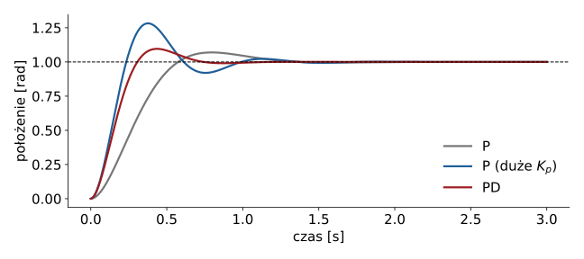

## Plan wykładu

1. Silnik prądu stałego: model i sterowanie przez mostek H
2. Pomiar położenia: enkodery
3. Silnik krokowy: sterowanie w pętli otwartej
4. Serwo modelarskie i serwonapęd przemysłowy
5. Silniki bezszczotkowe (BLDC/PMSM), przekładnie
6. Regulator PID: działanie, implementacja, strojenie
7. Regulacja kaskadowa w robocie


# Silniki


## Silnik prądu stałego: model

:::: columns
::: {.column width="55%"}
Część elektryczna i mechaniczna:

$$L\frac{di}{dt} = u - Ri - k_e\,\omega$$
$$J\frac{d\omega}{dt} = k_t\,i - b\,\omega - \tau_{obc}$$

- $k_t$: stała momentu, $k_e$: stała SEM (w SI $k_t = k_e$).
- Moment ∝ **prąd**, prędkość ustalona ∝ **napięcie**.
- Zwykle $L/R \ll J/b$: od napięcia do prędkości ≈ obiekt 1. rzędu.
:::
::: {.column width="45%"}
::: przyklad
**Stała czasowa mechaniczna** $T_m = \dfrac{JR}{k_tk_e}$: mały silnik DC ≈ 10–50 ms.

Z przekładnią $N$: moment na wyjściu $\times N$, prędkość $/N$, bezwładność obciążenia widziana przez silnik $/N^2$.
:::
:::
::::


## Mostek H i PWM

| S1 | S2 | S3 | S4 | Stan silnika |
|---|---|---|---|---|
| 1 | 0 | 0 | 1 | obroty w prawo |
| 0 | 1 | 1 | 0 | obroty w lewo |
| 0 | 1 | 0 | 1 | hamowanie (zwarcie uzwojeń) |
| 0 | 0 | 0 | 0 | wybieg |
| 1 | 1 | x | x | **zwarcie zasilania: zakazane!** |

- Cztery klucze tranzystorowe (W02) + diody zwrotne. Scalone: L298N, DRV8833, BTS7960.
- **Kierunek** = para kluczy, **napięcie średnie** = wypełnienie PWM (typowo 20 kHz, poza pasmem słyszalnym).
- Sterownik musi wprowadzać **czas martwy** (*dead time*) przy przełączaniu gałęzi.


## Enkodery

:::: columns
::: {.column width="55%"}
**Inkrementalny kwadraturowy**

- Sygnały A, B przesunięte o 90°: kierunek z kolejności zboczy; dekodowanie ×4.
- Liczy **przyrosty**: po włączeniu trzeba **bazować** (krańcówka, impuls Z).
- STM32: timer w trybie enkodera liczy sprzętowo.

**Absolutny**

- Kod Graya lub SSI/BiSS/SPI: położenie znane od razu. Standard w robotach.
:::
::: {.column width="45%"}
::: przyklad
**Rozdzielczość:** enkoder 1000 impulsów/obr., dekodowanie ×4, przekładnia 100:1:
$$\Delta\varphi = \frac{360°}{1000 \cdot 4 \cdot 100} = 0{,}0009°$$
:::

- Prędkość z enkodera: różnica położeń / okres próbkowania albo pomiar czasu między impulsami (przy małych prędkościach).
:::
::::


## Silnik krokowy

- Wirnik przeskakuje o **krok** (typowo 1,8°, 200 kroków/obr.) po każdym impulsie STEP sterownika.
- **Pętla otwarta**: pozycję znamy z liczby wysłanych impulsów (L1: zmienna `pozycja` w przerwaniu).
- **Mikrokrokowanie**: sterownik dzieli krok (1/2 … 1/256): płynniejszy ruch, mniej rezonansów.
- **Gubienie kroków**: za duże przyspieszenie lub obciążenie ⇒ silnik nie nadąża, a program o tym nie wie. Rozwiązanie: **rampa przyspieszenia** (profil trapezowy) i zapas momentu, albo enkoder (krokowy w pętli zamkniętej).
- Zalety: tani, prosty, duży moment przy małych prędkościach, trzyma pozycję. Wady: moment maleje z prędkością, pobiera prąd także w spoczynku.
- Zastosowania: drukarki 3D, plotery, CNC hobby, pozycjonery, **winda z L1**.


## Serwo modelarskie i serwonapęd przemysłowy

:::: columns
::: {.column width="50%"}
**Serwo modelarskie** (L1: drzwi windy)

- Silnik DC + przekładnia + potencjometr + wewnętrzny regulator położenia.
- Sygnał zadany: impuls 1–2 ms co 20 ms ⇒ kąt 0–180°.
- Tanie, ale: brak informacji zwrotnej do MCU, mała dokładność.
:::
::: {.column width="50%"}
**Serwonapęd przemysłowy**

- Silnik PMSM + enkoder absolutny + falownik z regulacją **kaskadową**: prąd (≈ 10–20 kHz) → prędkość (≈ 1–5 kHz) → położenie (≈ 0,5–1 kHz).
- Komunikacja: EtherCAT, CANopen (CiA 402), PROFINET (W09).
- Robot przemysłowy: jeden serwonapęd na przegub, często z przekładnią falową (*harmonic drive*) o przełożeniu 50–160.
:::
::::


## Silniki bezszczotkowe

- **BLDC / PMSM**: magnesy na wirniku, uzwojenia na stojanie, komutacja elektroniczna zamiast szczotek.
- Wymaga znajomości kąta wirnika: czujniki Halla, enkoder albo estymacja bezczujnikowa.
- **FOC** (*field-oriented control*): prądy fazowe przeliczane (transformacje Clarke i Parka) do układu wirującego z wirnikiem. Moment regulujemy jednym prądem $i_q$, dokładnie jak w silniku DC.
- Wysoka sprawność, gęstość mocy, trwałość: drony, roboty, pojazdy elektryczne.
- Mikrokontrolery do FOC: STM32G4 (sprzętowe wzmacniacze, komparatory, timery z czasem martwym).


# Regulator PID


## Regulator PID

$$u(t) = K_p\,e(t) + K_i\!\int_0^t e(\tau)\,d\tau + K_d\,\frac{de(t)}{dt}, \qquad e = y_{zad} - y$$

:::: columns
::: {.column width="55%"}
{width=100%}
:::
::: {.column width="45%"}
| Człon | Efekt |
|---|---|
| **P** | szybsza reakcja; zbyt duże $K_p$ ⇒ przeregulowanie, oscylacje |
| **I** | usuwa uchyb ustalony (np. od grawitacji); grozi *windup* |
| **D** | tłumi oscylacje, „przewiduje”; wzmacnia szum |
:::
::::

[Wykres: położenie napędu (model 1. rzędu + całkowanie) dla regulatora P i PD. Skrypt: `wyklady/assets/src/wykresy.py`.]{.maly}


## Implementacja cyfrowa

```cpp
struct PID {
  float Kp, Ki, Kd, Ts;          // wzmocnienia i okres próbkowania [s]
  float uMin, uMax;              // nasycenie elementu wykonawczego
  float calka = 0, poprzedniY = 0;

  float krok(float zadana, float y) {
    float e = zadana - y;
    float d = -(y - poprzedniY) / Ts;          // pochodna z pomiaru, nie z uchybu:
    poprzedniY = y;                            //   brak "kopnięcia" przy skoku wartości zadanej
    float u = Kp * e + calka + Kd * d;
    if (u > uMax)      u = uMax;               // nasycenie...
    else if (u < uMin) u = uMin;
    else               calka += Ki * e * Ts;   // ...i anti-windup: całkuj tylko bez nasycenia
    return u;
  }
};
```

- Wywoływane **ze stałym okresem** $T_s$: przerwanie timera (MCU) albo pętla `controller_manager` (ROS 2).
- Filtr dolnoprzepustowy na członie D, gdy pomiar jest zaszumiony.


## Strojenie

1. Zacznij od P: zwiększaj $K_p$ do szybkiej odpowiedzi z niewielkim przeregulowaniem.
2. Dodaj D, jeśli są oscylacje. Dodaj I, jeśli zostaje uchyb ustalony.
3. Metody: **Ziegler–Nichols** (wzmocnienie krytyczne $K_u$ i okres oscylacji $T_u$ ⇒ $K_p = 0{,}6K_u$, $T_i = T_u/2$, $T_d = T_u/8$), metody oparte na modelu, autotuning w serwonapędach.
4. Zawsze sprawdź: **nasycenie** (napięcie, prąd), **szum** pomiaru, **opóźnienie** pętli.

::: uwaga
W symulatorze (Gazebo, L4) strojenie jest bezpieczne. Na prawdziwym robocie zaczynaj od małych wzmocnień i ograniczonych prędkości.
:::


## Regulacja kaskadowa w robocie

| Pętla | Częstotliwość | Gdzie działa | Co reguluje |
|---|---|---|---|
| prądu (momentu) | 10–20 kHz | serwonapęd (falownik) | moment silnika |
| prędkości | 1–5 kHz | serwonapęd | prędkość przegubu |
| położenia | 0,5–1 kHz | serwonapęd / sterownik robota | kąt przegubu |
| trajektorii | 100–1000 Hz | sterownik robota, `ros2_control` | $q(t)$ z interpolacją |
| zadania | 10–100 Hz | planista, MoveIt, sterowanie kinematyczne (W06) | poza efektora |
| decyzji | 1–10 Hz | automat stanów, polityka uczona (W13) | co robić dalej |

Wewnętrzna pętla musi być znacznie szybsza od zewnętrznej. Dzięki temu na wyższym poziomie możemy przyjąć model $\dot{q} = u$ (W06).


## Podsumowanie

- Silnik DC: moment ∝ prąd, prędkość ∝ napięcie; kierunek i napięcie z mostka H i PWM.
- Położenie: enkoder (pętla zamknięta) albo zliczanie kroków (silnik krokowy, pętla otwarta).
- PID: trzy człony, implementacja ze stałym okresem, nasycenie i anti-windup.
- Robot = kaskada pętli od kHz (prąd) do Hz (decyzje). Na W11 zobaczymy, jak ROS 2 organizuje górne piętra tej kaskady.


## Źródła i dalsza lektura

- W. Bolton, *Mechatronics*, 7th ed., Pearson, 2019, rozdz. 9 (napędy), 22–23 (regulatory).
- K. J. Åström, R. M. Murray, *Feedback Systems: An Introduction for Scientists and Engineers*, 2nd ed., Princeton University Press, 2021, rozdz. 11 (PID), wolna wersja online.
- K. J. Åström, T. Hägglund, *Advanced PID Control*, ISA, 2006.
- B. Siciliano i in., *Robotics: Modelling, Planning and Control*, Springer, 2009, rozdz. 5 (napędy i czujniki) i 8 (sterowanie ruchem).
- Allegro MicroSystems, *A4988 datasheet*; Texas Instruments, *DRV8833 datasheet*.
- STMicroelectronics, *Motor Control SDK (X-CUBE-MCSDK)*: dokumentacja sterowania FOC dla STM32.

