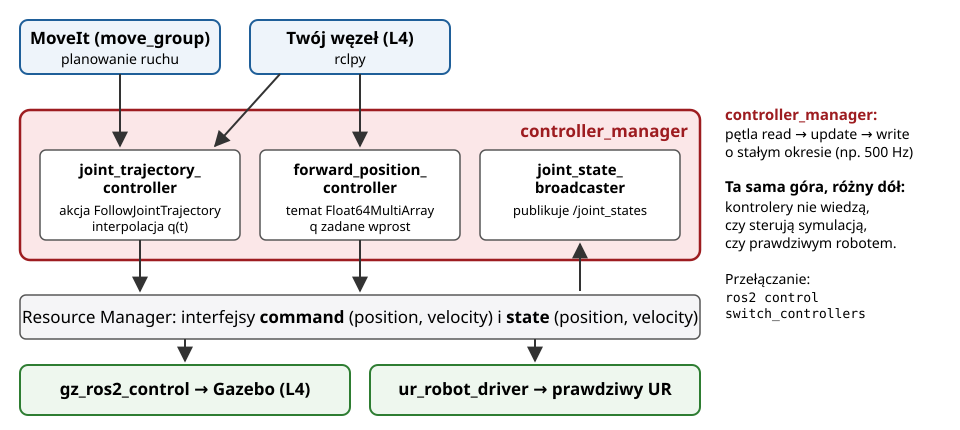

## Plan wykładu

1. Opis robota: URDF i xacro
2. Symulacja fizyczna: Gazebo (Harmonic)
3. `ros2_control`: kontrolery i interfejsy sprzętowe
4. Trzy sposoby sterowania tym samym robotem
5. MoveIt: planowanie ruchu
6. Od symulacji do rzeczywistości (*sim-to-real*)


# Model robota


## URDF: opis robota

:::: columns
::: {.column width="52%"}
```xml
<robot name="dwa_ogniwa">
  <link name="base_link"/>
  <link name="ramie">
    <visual><geometry>
      <box size="0.5 0.05 0.05"/></geometry></visual>
    <!-- <collision>: jak visual -->
    <inertial><mass value="1.2"/>
      <inertia ixx="0.001" iyy="0.025" izz="0.025"
        ixy="0" ixz="0" iyz="0"/>
    </inertial>
  </link>
  <joint name="bark" type="revolute">
    <parent link="base_link"/><child link="ramie"/>
    <origin xyz="0 0 0.1" rpy="0 0 0"/>
    <axis xyz="0 0 1"/>
    <limit lower="-3.14" upper="3.14"
           effort="50" velocity="2.0"/>
  </joint>
</robot>
```
:::
::: {.column width="48%"}
- **link**: ogniwo. Geometria wizualna, geometria kolizyjna, masa i tensor bezwładności (potrzebne do fizyki!).
- **joint**: przegub. Typ (`revolute`, `prismatic`, `continuous`, `fixed`), oś, **limity**.
- `origin`: MTJ z ogniwa-rodzica do przegubu (pozycja + kąty RPY). Zamiast parametrów DH (W05).
- **xacro**: makra i parametry, np. jeden plik dla UR3e/UR5e/UR10e.
- Z URDF korzystają: `robot_state_publisher` (tf2), rviz2, Gazebo, MoveIt.
:::
::::


## Gazebo Harmonic

- Symulator fizyki 3D: dynamika ciał sztywnych, kontakty, tarcie, grawitacja, **czujniki** (kamera, lidar, IMU, siła/moment).
- Silniki fizyki: DART (domyślny), Bullet. Świat opisany w **SDF**.
- Następca Gazebo Classic (koniec wsparcia 01.2025). Para z ROS 2 Jazzy: **Gazebo Harmonic** (LTS do 2028).
- Integracja z ROS 2:
  - `ros_gz_sim`: uruchomienie symulatora i wstawienie robota (`create`),
  - `ros_gz_bridge`: tłumaczenie tematów gz ↔ ROS 2 (np. `/clock`, obraz z kamery),
  - `gz_ros2_control`: wtyczka, dzięki której robot w Gazebo wygląda dla ROS 2 jak prawdziwy sprzęt.
- `use_sim_time: true`: węzły używają czasu symulacji z tematu `/clock`.

::: zrodlo
Gazebo Docs, <https://gazebosim.org/docs/harmonic>; ROS 2 Jazzy, *Installing Gazebo with ROS*.
:::


# ros2_control


## Architektura `ros2_control`

{width=90%}

::: zrodlo
Na podst.: ros2_control Documentation, *Getting Started*, <https://control.ros.org/jazzy/>.
:::


## Kontrolery robota UR w symulacji

Pakiet `ur_simulation_gz` (Universal Robots, gałąź `jazzy`) definiuje m.in.:

| Kontroler | Typ | Interfejs dla użytkownika |
|---|---|---|
| `joint_state_broadcaster` | odczyt stanów | temat `/joint_states` |
| `scaled_joint_trajectory_controller` (domyślny) | trajektoria ze skalowaniem prędkości | akcja `.../follow_joint_trajectory` |
| `joint_trajectory_controller` | trajektoria | akcja `.../follow_joint_trajectory`, temat `.../joint_trajectory` |
| `forward_position_controller` | pozycja wprost | temat `/forward_position_controller/commands` |
| `forward_velocity_controller` | prędkość wprost | temat `/forward_velocity_controller/commands` |

```bash
ros2 launch ur_simulation_gz ur_sim_control.launch.py ur_type:=ur5e
ros2 control list_controllers
ros2 control load_controller --set-state inactive forward_position_controller
ros2 control switch_controllers --deactivate scaled_joint_trajectory_controller \
                                --activate forward_position_controller
```


## Sposób 1: pozycja przegubów wprost

```bash
ros2 topic pub --once /forward_position_controller/commands std_msgs/msg/Float64MultiArray \
  "{data: [0.0, -1.57, 1.57, -1.57, -1.57, 0.0]}"
```

- Kontroler przekazuje wartości zadane **bez interpolacji**: robot „skacze” tak szybko, jak pozwolą regulatory w symulatorze.
- Odpowiednik interfejsu $q = q_d$ z W06. Użyteczne, gdy **my** generujemy gęstą trajektorię (np. sterowanie kinematyczne z pętlą 100 Hz, polityka uczona w L5).
- Ryzyko: duży skok wartości zadanej = gwałtowny ruch. Na prawdziwym robocie tylko z ograniczeniami.


## Sposób 2: trajektoria w przestrzeni przegubów

```python
from rclpy.action import ActionClient
from control_msgs.action import FollowJointTrajectory
from trajectory_msgs.msg import JointTrajectoryPoint
from builtin_interfaces.msg import Duration

cel = FollowJointTrajectory.Goal()
cel.trajectory.joint_names = ['shoulder_pan_joint', 'shoulder_lift_joint', 'elbow_joint',
                              'wrist_1_joint', 'wrist_2_joint', 'wrist_3_joint']
for q, t in [([0.0, -1.57, 1.57, -1.57, -1.57, 0.0], 3),
             ([0.8, -1.20, 1.20, -1.57, -1.57, 0.0], 6)]:
    p = JointTrajectoryPoint(positions=q, velocities=[0.0] * 6)
    p.time_from_start = Duration(sec=t)
    cel.trajectory.points.append(p)
klient = ActionClient(wezel, FollowJointTrajectory,
                      '/joint_trajectory_controller/follow_joint_trajectory')
klient.send_goal_async(cel)
```

- Punkty pośrednie z czasem. Kontroler **interpoluje** (wielomianami) i pilnuje tolerancji.
- **Akcja**: dostajemy informację zwrotną w trakcie i wynik na końcu, można anulować.
- Tak steruje robotem MoveIt i większość aplikacji przemysłowych.


## Sposób 3: MoveIt

:::: columns
::: {.column width="52%"}
::: maly
- Podajemy **cel w przestrzeni zadania** (poza chwytaka) albo w przestrzeni przegubów.
- `move_group` wykonuje:
  1. kinematykę odwrotną (W05),
  2. planowanie ścieżki bez kolizji (OMPL, Pilz, STOMP),
  3. parametryzację w czasie (limity prędkości i przyspieszeń),
  4. wysłanie trajektorii do `joint_trajectory_controller`.
- **Scena planowania**: przeszkody, obiekty dołączone do chwytaka.
- Interfejsy: panel *MotionPlanning* w rviz2, API C++ `MoveGroupInterface`, Python `moveit_py`.
:::
:::
::: {.column width="48%"}
```bash
ros2 launch ur_simulation_gz ur_sim_moveit.launch.py \
     ur_type:=ur5e
```

::: przyklad
**Ścieżka kartezjańska**: MoveIt potrafi też wyznaczyć ruch po prostej w przestrzeni zadania (`computeCartesianPath`). To dyskretny odpowiednik sterowania kinematycznego z W06.
:::
:::
::::


## Porównanie trzech sposobów

| | Pozycja wprost | Trajektoria (JTC) | MoveIt |
|---|---|---|---|
| wejście | $q_d$ | $q(t_k)$ punkty z czasem | poza celu / $q$ celu |
| interpolacja | brak | tak | tak |
| kolizje | nie sprawdza | nie sprawdza | **sprawdza** |
| kinematyka odwrotna | nasza sprawa | nasza sprawa | wbudowana |
| typowe użycie | własne regulatory, uczenie | sekwencje punktów | aplikacje, pick & place |
| złożoność dla programisty | niska | średnia | niska (ale ciężki system) |

W L4 porównasz je na tej samej sekwencji ruchów UR5e.


# Sim-to-real


## Od symulacji do rzeczywistości

- **Luka rzeczywistości** (*reality gap*): tarcie, luzy, elastyczność, opóźnienia komunikacji, szum czujników, niedokładne masy w URDF.
- Co przenosi się dobrze: logika, kinematyka, planowanie, interfejsy ROS 2 (ten sam kod, inny `hardware_interface`).
- Co wymaga pracy: strojenie regulatorów, kontakt i chwytanie, percepcja (oświetlenie, odbicia).
- Techniki: identyfikacja parametrów, **randomizacja domeny** (losowe masy, tarcia, tekstury w symulacji), dostrajanie na obiekcie.
- Dla UR: `ur_robot_driver` + URSim (symulator producenta) + prawdziwy robot. Ten sam `ros2_control`.


## Podsumowanie

- URDF opisuje robota, Gazebo symuluje fizykę, `gz_ros2_control` udaje sprzęt.
- `ros2_control` oddziela kontrolery od sprzętu. Wybór kontrolera = wybór interfejsu sterowania.
- Trzy poziomy: pozycja wprost, trajektoria, planowanie ruchu (MoveIt).

::: uwaga
**Przed L4:** w The Construct otwórz rosject przygotowany przez prowadzącego (link na ePortalu) i uruchom `ur_sim_control.launch.py`. Sprawdź, czy widzisz robota w Gazebo i rviz2.
:::


## Źródła i dalsza lektura

- ros2_control Documentation (Jazzy), <https://control.ros.org/jazzy/>.
- Universal Robots, *Universal_Robots_ROS2_GZ_Simulation*, <https://github.com/UniversalRobots/Universal_Robots_ROS2_GZ_Simulation>.
- LearnRoboticsWROS, *ur_yt_sim* (UR5 + Robotiq w Gazebo Classic i MoveIt, materiał do samodzielnej nauki), <https://github.com/LearnRoboticsWROS/ur_yt_sim>.
- MoveIt 2 Documentation, *Getting Started*, *Move Group C++ Interface*, <https://moveit.picknik.ai>.
- Gazebo Harmonic Documentation, <https://gazebosim.org/docs/harmonic>.
- ROS 2 Jazzy, *URDF tutorials*, <https://docs.ros.org/en/jazzy/Tutorials/Intermediate/URDF/URDF-Main.html>.
- S. Chitta i in., *ros_control: A generic and simple control framework for ROS*, JOSS 2(20), 2017.

