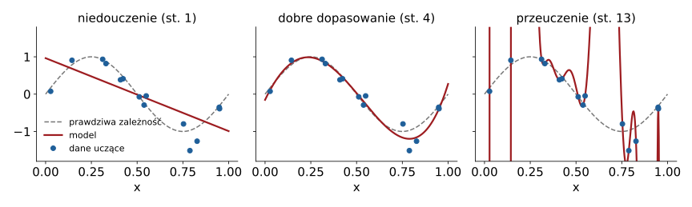

## Plan wykładu

1. Uczenie maszynowe w systemach mechatronicznych
2. Uczenie nadzorowane: dane, model, funkcja straty, optymalizacja
3. Uogólnianie: niedouczenie, przeuczenie, podział danych
4. Sieci neuronowe i ich trenowanie
5. Sieci splotowe (CNN) w widzeniu maszynowym
6. Transformer i uwaga (*attention*)
7. Praktyka: dane, obliczenia, ewaluacja


# Po co ML w mechatronice


## Gdzie klasyczne sterowanie nie wystarcza

| Zadanie | Klasycznie | Z uczeniem maszynowym |
|---|---|---|
| kontrola jakości na taśmie | progowanie obrazu, ręcznie dobrane cechy | klasyfikator CNN uczony na przykładach |
| diagnostyka łożysk | FFT + progi | wykrywanie anomalii w drganiach |
| chwytanie nieznanych obiektów | model CAD każdego obiektu | sieć przewidująca punkt chwytu z obrazu |
| sterowanie z obrazu | percepcja → planowanie → sterowanie (osobno) | **polityka wizja → akcja** (W13, L5) |
| strojenie regulatora | reguły, eksperymenty | optymalizacja bayesowska, uczenie ze wzmocnieniem |

- ML nie zastępuje fizyki: model kinematyki (W05) i regulatory (W10) dalej działają „pod spodem”.
- ML przydaje się tam, gdzie **trudno napisać reguły**, ale **łatwo zebrać przykłady**.


## Rodzaje uczenia

- **Nadzorowane**: pary (wejście $x$, poprawna odpowiedź $y$). Klasyfikacja, regresja. *Uczenie przez naśladowanie (W13) to przypadek nadzorowany: $x$ = obserwacja, $y$ = akcja człowieka.*
- **Nienadzorowane**: tylko $x$. Grupowanie, redukcja wymiaru, wykrywanie anomalii.
- **Ze wzmocnieniem** (RL): agent działa w środowisku i dostaje nagrodę. Wymaga wielu prób: zwykle w symulacji.
- **Samonadzorowane**: etykiety z samych danych (przewiduj następną klatkę, brakujący fragment). Podstawa dużych modeli.


# Uczenie nadzorowane


## Składniki

:::: columns
::: {.column width="55%"}
1. **Dane**: $\mathcal{D} = \{(x_i, y_i)\}_{i=1}^N$.
2. **Model** z parametrami $\theta$: $\hat{y} = f_\theta(x)$.
3. **Funkcja straty**: jak bardzo się mylimy.
   - regresja: $\mathcal{L} = \frac{1}{N}\sum (\hat{y}_i - y_i)^2$ (MSE),
   - klasyfikacja: entropia krzyżowa.
4. **Optymalizacja**: szukamy $\theta$ minimalizującego $\mathcal{L}$. Spadek gradientu:
$$\theta \leftarrow \theta - \eta\,\nabla_\theta \mathcal{L}$$
:::
::: {.column width="45%"}
::: przyklad
**Analogia z W06.** Sterowanie kinematyczne też minimalizuje błąd krok po kroku: $\dot{q} = -J^{\dagger}Kr$. Spadek gradientu to „sterownik” w przestrzeni parametrów $\theta$, a $\eta$ (*learning rate*) pełni rolę wzmocnienia $K$.
:::
:::
::::


## Uogólnianie

{width=85%}

- Cel: dobre działanie na **nowych** danych, nie tylko na uczących.
- Podział danych: **uczące** (dopasowanie $\theta$), **walidacyjne** (wybór hiperparametrów, wczesne zatrzymanie), **testowe** (jednorazowa, uczciwa ocena).
- Przeciw przeuczeniu: więcej danych, augmentacja, regularyzacja, prostszy model, wczesne zatrzymanie.


# Sieci neuronowe


## Neuron i sieć wielowarstwowa

:::: columns
::: {.column width="55%"}
- Neuron: $a = \sigma(w^Tx + b)$, gdzie $\sigma$ to nieliniowa funkcja aktywacji, np. **ReLU** $\sigma(z) = \max(0, z)$.
- **MLP**: warstwy neuronów, wyjście jednej to wejście następnej:
$$f_\theta(x) = W_3\,\sigma(W_2\,\sigma(W_1x + b_1) + b_2) + b_3$$
- Twierdzenie o uniwersalnej aproksymacji: dość duża sieć przybliży dowolną ciągłą funkcję.
- **Propagacja wsteczna**: reguła łańcuchowa liczona automatycznie (PyTorch `autograd`).
:::
::: {.column width="45%"}
```python
import torch, torch.nn as nn

model = nn.Sequential(
    nn.Linear(6, 64), nn.ReLU(),
    nn.Linear(64, 64), nn.ReLU(),
    nn.Linear(64, 3))
opt = torch.optim.Adam(model.parameters(), lr=1e-3)

for epoka in range(100):
    for x, y in loader:          # mini-paczki
        loss = ((model(x) - y)**2).mean()
        opt.zero_grad()
        loss.backward()          # gradienty
        opt.step()               # krok optymalizacji
```
:::
::::

::: {.przyklad .maly}
Przykład regresji z robotyki: nauczyć sieć kinematyki prostej KUKA KR5 z próbek $(q, s_e(q))$ wygenerowanych w UAIbot. Dobre ćwiczenie: porównaj z dokładnym modelem z W05.
:::


## Sieci splotowe (CNN)

:::: columns
::: {.column width="55%"}
- Obraz 224×224×3 = 150 tys. liczb. MLP „na pikselach” ma za dużo parametrów i ignoruje strukturę.
- **Splot**: mały filtr (np. 3×3) przesuwany po obrazie. Te same wagi wszędzie: wykrywa krawędź niezależnie od położenia.
- Kolejne warstwy: krawędzie → tekstury → części → obiekty.
- **Uczenie transferowe**: bierzemy sieć wytrenowaną na ImageNet (np. ResNet-18) i dostrajamy do swojego zadania na kilkuset obrazach.
- W politykach robotów (W13) CNN (ResNet) zamienia obraz z kamery na wektor cech.
:::
::: {.column width="45%"}
| Zadanie widzenia | Wyjście |
|---|---|
| klasyfikacja | klasa obrazu |
| detekcja | prostokąty + klasy (YOLO) |
| segmentacja | klasa każdego piksela |
| estymacja pozy | 6D poza obiektu |
| punkty chwytu | pozycja i orientacja chwytaka |
:::
::::


## Transformer i mechanizm uwagi

- Wejście: ciąg **tokenów** (słowa, fragmenty obrazu, stany robota).
- **Uwaga** (*attention*): każdy token „pyta” pozostałe, które są dla niego istotne, i miesza ich informację z wagami:
$$\text{Attention}(Q,K,V) = \operatorname{softmax}\!\left(\frac{QK^T}{\sqrt{d}}\right)V$$
- Skaluje się na ogromne zbiory danych: podstawa modeli językowych (LLM) i **modeli wizja–język–akcja (VLA)**.
- W robotyce (W13): **ACT** używa transformera, żeby z obrazu i stanu przewidzieć od razu **ciąg** przyszłych akcji.


# Praktyka


## Praktyka inżynierska

- **Dane ważniejsze niż model**: pokrycie sytuacji, jakość etykiet, spójność. W robotyce: oświetlenie, ustawienie kamery, różnorodność demonstracji.
- **Przesunięcie rozkładu** (*distribution shift*): świat w użyciu różni się od danych uczących. Model zawodzi po cichu.
- **Metryki**: dokładność, precyzja i czułość, MSE. W sterowaniu: **skuteczność wykonania zadania** (L5: odsetek udanych epizodów).
- **Obliczenia**: trening na GPU (Colab, klaster uczelni), wnioskowanie często na CPU lub w module brzegowym (Jetson). Mikrokontrolery: TinyML (STM32Cube.AI, TensorFlow Lite Micro).
- **Bezpieczeństwo**: model uczony nie daje gwarancji. W systemie mechatronicznym zawsze warstwa nadzoru: limity, STOP, strefy (W07).


## Podsumowanie

- Uczenie nadzorowane: dane + model + funkcja straty + spadek gradientu.
- Celem jest uogólnianie: pilnuj podziału danych i przeuczenia.
- CNN widzą, transformery łączą informację z wielu źródeł i kroków czasu.
- Na W13 złożymy to w **politykę robota**, która uczy się z demonstracji.


## Źródła i dalsza lektura

- I. Goodfellow, Y. Bengio, A. Courville, *Deep Learning*, MIT Press, 2016, <https://www.deeplearningbook.org> (rozdz. 5, 6, 9).
- S. J. D. Prince, *Understanding Deep Learning*, MIT Press, 2023, <https://udlbook.github.io/udlbook/> (wolna wersja PDF).
- A. Vaswani i in., *Attention Is All You Need*, NeurIPS 2017.
- K. He i in., *Deep Residual Learning for Image Recognition*, CVPR 2016.
- PyTorch, *Learn the Basics*, <https://pytorch.org/tutorials/beginner/basics/intro.html>.

