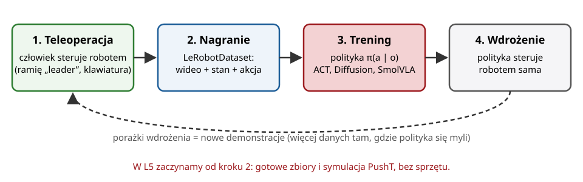

## Plan wykładu

1. Polityka robota: obserwacja → akcja
2. Klonowanie zachowań i jego pułapki
3. Nowoczesne polityki: ACT, Diffusion Policy
4. Modele wizja–język–akcja (VLA)
5. LeRobot: dane, trening, ewaluacja
6. Polityka uczona w systemie mechatronicznym


# Polityka


## Klasyczny stos a polityka end-to-end

:::: columns
::: {.column width="50%"}
**Klasycznie (W04–W11)**

1. percepcja: gdzie jest obiekt (poza 6D),
2. planowanie: kinematyka odwrotna, MoveIt,
3. sterowanie: trajektoria → regulatory.

Każdy moduł projektuje inżynier. Działa świetnie w **strukturyzowanym** otoczeniu (fabryka).
:::
::: {.column width="50%"}
**Polityka uczona**

$$a_t = \pi_\theta(o_t)$$

- $o_t$: obrazy z kamer + stan robota (kąty przegubów),
- $a_t$: akcja (zadane kąty przegubów, pozycja chwytaka, prędkość),
- $\pi_\theta$: sieć neuronowa, typowo 10–50 Hz.

Uczona z **demonstracji** człowieka. Radzi sobie z zadaniami trudnymi do zaprogramowania: składanie ubrań, wkładanie kabli, kontakt.
:::
::::


## Klonowanie zachowań (*behavior cloning*)

- Zbierz demonstracje: pary $(o_t, a_t)$ od człowieka. Naucz $\pi_\theta$ jak w W12: $\min_\theta \sum \|\pi_\theta(o_t) - a_t\|^2$.
- Proste i skuteczne, ale ma dwie pułapki:

::: def
**Kumulacja błędów** (*compounding error*): mały błąd przesuwa robota do stanu, którego nie było w demonstracjach. Tam polityka myli się bardziej, więc odjeżdża jeszcze dalej. Błąd rośnie z długością zadania.
:::

::: def
**Wielomodalność**: w tej samej sytuacji człowiek raz omija przeszkodę z lewej, raz z prawej. Regresja MSE uśrednia: polityka jedzie **prosto w przeszkodę**.
:::

- Środki zaradcze: więcej zróżnicowanych danych (także „jak wrócić z błędu”), DAgger, **przewidywanie ciągów akcji**, modele generatywne.


## ACT: Action Chunking with Transformers

:::: columns
::: {.column width="55%"}
::: maly
- Zhao i in., 2023 (projekt ALOHA): tanie ramiona + precyzyjne zadania dwuręczne.
- **Chunking**: zamiast jednej akcji sieć przewiduje od razu **$k$ kolejnych** (np. $k = 100$ przy 50 Hz = 2 s). Efektywny horyzont decyzji krótszy $k$ razy: mniej kumulacji błędów.
- **Temporal ensembling**: nakładające się ciągi uśredniane z wagami: płynny ruch.
- Architektura: ResNet-18 (obrazy) + transformer (enkoder–dekoder), trenowana jako CVAE (zmienna ukryta „styl” demonstracji).
- ~50 demonstracji na zadanie. Zalecana pierwsza polityka w LeRobot.
:::
:::
::: {.column width="45%"}
| Parametr | Typowo |
|---|---|
| kamery | 1–4 × 480×640 |
| stan | kąty przegubów |
| akcja | zadane kąty (14 dla 2 ramion) |
| chunk $k$ | 100 |
| częstotliwość | 50 Hz |
| czas treningu | 1–5 h na GPU |
:::
::::

::: zrodlo
T. Z. Zhao, V. Kumar, S. Levine, C. Finn, *Learning Fine-Grained Bimanual Manipulation with Low-Cost Hardware*, RSS 2023.
:::


## Diffusion Policy

:::: columns
::: {.column width="55%"}
::: maly
- Chi i in., 2023: polityka jako **model dyfuzyjny** (jak generatory obrazów).
- Start od szumu w przestrzeni ciągów akcji, a potem $K$ kroków „odszumiania” warunkowanych obserwacją.
- Naturalnie modeluje **wielomodalność**: wybiera jeden z wariantów (lewo *albo* prawo), zamiast uśredniać.
- Wada: wolniejsze wnioskowanie (wiele kroków odszumiania). Rozwiązania: DDIM, mniej kroków.
- Zadanie wzorcowe **PushT**: popchnij klocek w kształcie T na docelowe miejsce. Akcja: pozycja 2D popychacza. W L5 uruchomisz gotową politykę dla PushT.
:::
:::
::: {.column width="45%"}
```text
a^K ~ N(0, I)            # szum
for k = K ... 1:
    a^(k-1) = odszumiaj(a^k, o_t, k)
wykonaj a^0[0 : n]        # pierwsze n akcji
```
:::
::::

::: zrodlo
C. Chi i in., *Diffusion Policy: Visuomotor Policy Learning via Action Diffusion*, RSS 2023.
:::


# Modele VLA


## Wizja + język + akcja

- **VLA** (*vision-language-action*): duży model wizyjno-językowy dostrojony do generowania akcji robota. Polecenie w języku naturalnym: „włóż czerwony klocek do miski”.
- Trenowane na dużych, wspólnych zbiorach z wielu robotów (Open X-Embodiment: 1M+ epizodów, 22 typy robotów).
- Przykłady: RT-2 (Google DeepMind, 2023), OpenVLA (2024), π0 i π0.5 (Physical Intelligence, 2024–2025), **SmolVLA** (Hugging Face, 2025, ~450 M parametrów, działa na pojedynczym GPU).
- Kierunek: model bazowy (*foundation model*) + dostrojenie na kilkudziesięciu demonstracjach własnego zadania.
- Ograniczenia: dane, czas wnioskowania, brak gwarancji bezpieczeństwa, trudna ewaluacja.


# LeRobot


## LeRobot: biblioteka Hugging Face

{width=92%}

- Otwarta biblioteka (PyTorch): zbiory danych, polityki (ACT, Diffusion, VQ-BeT, SmolVLA, π0…), symulatory (PushT, ALOHA, LIBERO, Meta-World), sterowniki tanich ramion (SO-101, Koch).
- **LeRobotDataset**: epizody, stan i akcje w Parquet, obrazy jako wideo MP4, metadane (fps, cechy). Hostowane na Hugging Face Hub, podgląd w przeglądarce.


## LeRobot z wiersza poleceń

```bash
pip install 'lerobot[pusht,diffusion,training]'     # biblioteka + symulator PushT + trening

# ewaluacja gotowej polityki w symulacji (model zmigrowany do formatu LeRobot 0.6, patrz L5)
lerobot-eval --policy.path=diffusion_pusht_migrated \
             --env.type=pusht --eval.n_episodes=10 --policy.device=cuda

# trening własnej polityki na zbiorze z Hub
lerobot-train --dataset.repo_id=lerobot/pusht --policy.type=diffusion \
              --env.type=pusht --steps=5000 --eval_steps=0 --policy.device=cuda \
              --policy.push_to_hub=false --output_dir=outputs/train/dp_pusht
```

- Wynik ewaluacji: **odsetek sukcesów**, średnia nagroda, wideo epizodów.
- Czas: ewaluacja kilka minut, pełny trening Diffusion Policy dla PushT to godziny na GPU. Na L5 trenujemy krótko i porównujemy z modelem gotowym.

::: zrodlo
LeRobot Documentation, *Installation*, *Cheat Sheet*, <https://huggingface.co/docs/lerobot>. Polecenia dla wersji 0.6.x.
:::


# W systemie mechatronicznym


## Polityka uczona w systemie mechatronicznym

| Warstwa | Kto decyduje | Częstotliwość |
|---|---|---|
| zadanie („posprzątaj stół”) | człowiek, planista, LLM | rzadko |
| **polityka wizja → akcja** | sieć neuronowa (ACT, VLA) | 10–50 Hz |
| trajektoria przegubów | `forward_position_controller`, JTC (W11) | 100–500 Hz |
| regulatory napędów | PID, FOC w serwonapędach (W10) | kHz |
| **nadzór bezpieczeństwa** | logika deterministyczna, STOP (W03, W07) | zawsze |

- Polityka zastępuje **percepcję i planowanie**, nie regulatory i nie bezpieczeństwo.
- Integracja z ROS 2: węzeł z polityką subskrybuje obrazy i `/joint_states`, publikuje wartości zadane do kontrolera z W11.


## Podsumowanie

- Polityka $\pi(a \mid o)$ uczona z demonstracji to klonowanie zachowań: uczenie nadzorowane z pułapkami (kumulacja błędów, wielomodalność).
- ACT (ciągi akcji + transformer) i Diffusion Policy (generatywne odszumianie) to dzisiejsze standardy. VLA dodają język i skalę.
- LeRobot łączy dane, trening, symulację i tani sprzęt w jednym ekosystemie.

::: uwaga
**Na L5** (Google Colab z GPU): obejrzysz zbiór `lerobot/pusht`, uruchomisz gotową Diffusion Policy w symulatorze i wytrenujesz własną krótko, a potem porównasz wyniki.
:::


## Źródła i dalsza lektura

::: maly
- R. Cadène i in., *LeRobot: State-of-the-art Machine Learning for Real-World Robotics in PyTorch*, 2024, <https://github.com/huggingface/lerobot>.
- LeRobot Documentation, <https://huggingface.co/docs/lerobot>; *Notebooks* (Colab: trening ACT, SmolVLA).
- T. Z. Zhao i in., *Learning Fine-Grained Bimanual Manipulation with Low-Cost Hardware* (ACT), RSS 2023.
- C. Chi i in., *Diffusion Policy: Visuomotor Policy Learning via Action Diffusion*, RSS 2023.
- S. Ross, G. Gordon, D. Bagnell, *A Reduction of Imitation Learning and Structured Prediction to No-Regret Online Learning* (DAgger), AISTATS 2011.
- Open X-Embodiment Collaboration, *Open X-Embodiment: Robotic Learning Datasets and RT-X Models*, ICRA 2024.
- M. Shukor i in., *SmolVLA: A Vision-Language-Action Model for Affordable and Efficient Robotics*, 2025.
- K. Black i in., *π0: A Vision-Language-Action Flow Model for General Robot Control*, 2024.
:::

