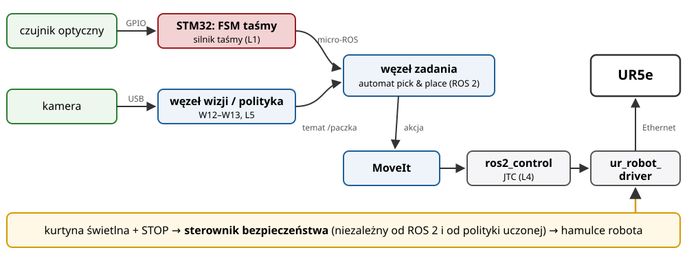

## Plan wykładu

1. Studium przypadku: stanowisko sortowania z robotem
2. Integracja: interfejsy, czas, awarie
3. Bezpieczeństwo robotów i koboty
4. Kierunki rozwoju
5. Powtórka: mapa kursu i zakres kolokwium

# Studium przypadku

## Stanowisko: taśma + robot + kamera

:::: columns
::: {.column width="50%"}
**Zadanie:** paczki jadą taśmą. Robot UR5e zdejmuje je i odkłada do pojemnika zależnie od rodzaju.

- **Taśma**: silnik krokowy lub DC, sterownik STM32, czujnik optyczny na końcu taśmy (L1).
- **Robot**: UR5e + chwytak, ROS 2 + `ros2_control` (L3, L4).
- **Kamera**: rozpoznanie paczki (W12) lub polityka chwytania z obrazu (W13, L5).
- **Nadzór**: kurtyna świetlna, STOP awaryjny, sterownik bezpieczeństwa.
:::
::: {.column width="50%"}
| Blok | Wykład | Lab |
|---|---|---|
| czujniki, elektronika | W02 | L1 |
| sterownik taśmy (FSM) | W03 | L1 |
| kinematyka robota | W04–W06 | L2 |
| komunikacja modułów | W07–W09 | L3 |
| napędy i trajektorie | W10–W11 | L4 |
| rozpoznanie / chwyt | W12–W13 | L5 |
:::
::::

## Architektura stanowiska

{width=92%}

- Każda strzałka to **interfejs**: typ wiadomości, częstotliwość, QoS, zachowanie przy utracie połączenia.
- Automat stanów pojawia się na dwóch poziomach: taśma (MCU) i zadanie (węzeł ROS 2).

## Integracja: o czym trzeba pomyśleć

- **Czas i synchronizacja**: obraz z kamery ma opóźnienie; taśma się rusza. Znacznik czasu w wiadomości + predykcja pozycji paczki.
- **Kalibracja**: MTJ kamera → podstawa robota (*hand-eye calibration*). Bez niej wizja „nie trafia”.
- **Stany awaryjne**: co robi robot, gdy padnie węzeł wizji? Gdy taśma stanie? Każdy moduł ma zdefiniowane zachowanie przy utracie komunikacji (QoS *liveliness*, *deadline*, W08).
- **Uruchomienie i diagnostyka**: logi, `ros2 bag`, wizualizacja w rviz2, testy w symulacji (SIL) przed obiektem.
- **Zespół**: każdy blok ma właściciela i jasny interfejs (PEU_K01). Integrację planujemy od początku, a nie „na koniec”.

# Bezpieczeństwo

## Bezpieczeństwo robotów i koboty

| Tryb współpracy (ISO 10218, ISO/TS 15066) | Opis |
|---|---|
| zatrzymanie monitorowane | człowiek wchodzi, robot staje i czeka |
| prowadzenie ręczne | człowiek prowadzi robota (uczenie trajektorii) |
| monitorowanie prędkości i odległości | im bliżej człowiek, tym wolniej robot |
| ograniczenie mocy i siły | kontakt dozwolony, ale siły poniżej progów biomechanicznych |

- **Kobot** (UR, Franka, KUKA iiwa) ≠ robot bezpieczny sam z siebie. Bezpieczna jest **aplikacja** po ocenie ryzyka (np. ostre narzędzie w chwytaku zmienia wszystko).
- Funkcje bezpieczeństwa realizuje certyfikowany sterownik bezpieczeństwa, **nie** zwykły węzeł ROS 2 ani polityka uczona.

# Trendy

## Kierunki rozwoju

- **Cyfrowe bliźniaki**: model fabryki zsynchronizowany z rzeczywistością (NVIDIA Isaac Sim, Gazebo, Siemens Process Simulate).
- **Modele bazowe dla robotów**: VLA (π0.5, SmolVLA, GR00T), uczenie na danych z wielu robotów (W13).
- **Humanoidy i manipulatory mobilne**: jeden robot do wielu zadań w środowisku zbudowanym dla ludzi.
- **Tanie, otwarte platformy**: SO-101, LeKiwi, ramiona drukowane w 3D: robotyka dostępna dla każdego zespołu studenckiego.
- **Edge AI i TinyML**: wnioskowanie na urządzeniu (Jetson, STM32 z akceleratorem NPU, np. STM32N6).
- **Symulacja w chmurze i przeglądarce**: ten kurs w całości (Wokwi, Colab, The Construct).
- **Nowe standardy komunikacji**: TSN, OPC UA FX, `rmw_zenoh` w ROS 2.

## Jak uczyć się dalej (PEU_K02)

- Dokumentacje, nie tylko tutoriale: RM0490 (STM32), docs.ros.org, control.ros.org, huggingface.co/docs/lerobot.
- Kursy otwarte: UAIbot *Robotic Manipulators* (pełna wersja: dynamika, sterowanie dynamiczne), *Modern Robotics* (Lynch, Park; wykłady wideo), The Construct.
- Projekty: koło naukowe, zawody (Robotour, Eurobot, RoboCup), własny kobot z SO-101 + LeRobot.
- Otwarte oprogramowanie: zgłoszenie błędu lub poprawka dokumentacji w projekcie ROS 2 / LeRobot to realne doświadczenie inżynierskie.

# Powtórka

## Mapa kursu

::: maly
| Blok | Najważniejsze pojęcia i wzory |
|---|---|
| system mechatroniczny | bloki funkcyjne, pętla sprzężenia, model V, SIL/HIL |
| elektronika | dzielnik, wzmacniacz $1 + R_2/R_1$, $f_g = 1/(2\pi RC)$, ADC $V_{ref}/2^N$, PWM $\bar{U} = D\,V_{DD}$, MOSFET + dioda zwrotna |
| STM32 | GPIO (tryby), timer $f = f_{TIM}/((PSC+1)(ARR+1))$, przerwania, `volatile`, FSM bez `delay()` |
| opis przestrzenny | macierz obrotu, MTJ, składanie z lewej / z prawej |
| kinematyka | DH ($\theta, d, \alpha, a$), kinematyka prosta i odwrotna (2R) |
| sterowanie kinematyczne | $\xi = J\dot{q}$, osobliwości, $A^{\dagger(\epsilon)}$, $u = -J_r^{\dagger}(Kr + \partial r/\partial t)$ |
| oprogramowanie i komunikacja | warstwy, testy, CI; ROS 2: węzeł/temat/usługa/akcja, QoS; UART, I²C, SPI, CAN, EtherCAT |
| napędy | model silnika DC, mostek H, enkoder, krokowy, PID + anti-windup, kaskada |
| uczenie maszynowe | uczenie nadzorowane, przeuczenie, CNN, klonowanie zachowań, ACT, Diffusion Policy, VLA |
:::

## Kolokwium (W15)

- 45 minut, bez materiałów pomocniczych, kalkulator dozwolony.
- Część A: pytania testowe i krótkie odpowiedzi (pojęcia z mapy kursu).
- Część B: 2–3 krótkie zadania obliczeniowe, np.:
  - dobór PSC/ARR timera dla zadanej częstotliwości,
  - rozdzielczość ADC lub enkodera,
  - MTJ złożenia przekształceń, kinematyka prosta 2R,
  - diagram automatu stanów dla prostego urządzenia,
  - wybór interfejsu komunikacyjnego z uzasadnieniem.
- Zakres: efekty PEU_W01–PEU_W04 z karty przedmiotu.

## Źródła i dalsza lektura

- ISO 10218-1/-2:2025 *Robotics: Safety requirements*; ISO/TS 15066:2016 *Collaborative robots*.
- R. Isermann, *Mechatronic Systems: Fundamentals*, Springer, 2005 (integracja systemu).
- K. M. Lynch, F. C. Park, *Modern Robotics*, Cambridge University Press, 2017, <https://modernrobotics.northwestern.edu>.
- UAIbot, *Robotic Manipulator Course*, <https://uaibot.github.io/class_presentations/>.
- LeRobot, *SO-101*, *LeKiwi*: <https://huggingface.co/docs/lerobot>.
- ROS 2 Documentation (Jazzy), <https://docs.ros.org/en/jazzy/>.

